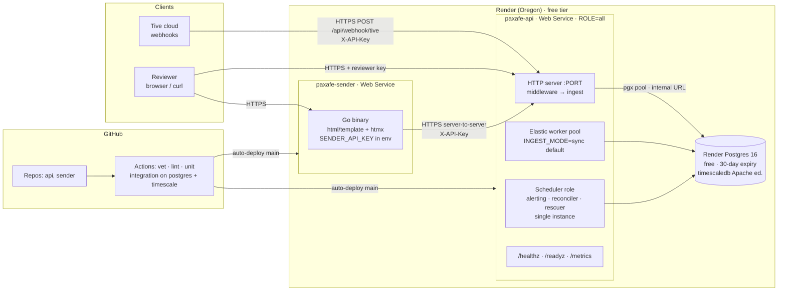
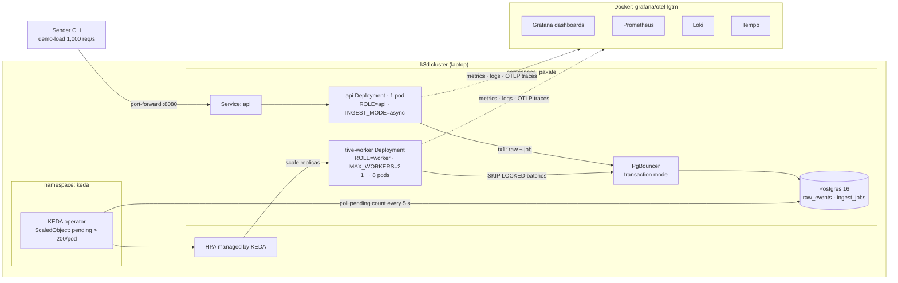

# PAXAFE Tive Integration — Design Document

Status: approved for implementation · Owner: Yuvi · Date: 2026-11-04 · Due: Fri 2026-11-06 EOB

**Updated 2026-11-06 (see §24):** the tenant comes from the API key only (no account routing, no `common-pool`, no `tenant_sources`, no `TENANT_MISMATCH`); `EntryTimeUtc` is ignored; `status` is `flagged` iff any flag; there is no temperature-band flag (`TEMP_EXCURSION` removed); `POST /api/webhook/tive` is the primary path. Where older text below still describes account routing, that text is superseded. The files in `specs/001-integration-api/expected/` are the golden outputs and win over this document.

This is the single source of truth for design decisions. Specs (`specs/`), ADRs (`docs/adr/`), and code must agree with it; when they diverge, update this document first.

---

## 0. Scope

**Required by the assignment:** receive Tive payloads at the webhook, authenticate with an API key, validate, transform to PAXAFE sensor + location, persist to a database we design; a Mock Tive Sender; both deployed; tests for transformation logic; README.

**Build plan:** milestones M0–M7 (§23) deliver the required scope plus cheap, high-signal extras. M8a–M8c are optional and only start after M7 is complete and deployed. Everything else in this document is design intent: describe it in the README, do not build it unless a milestone says so.

**Rule for Claude Code:** work on one milestone at a time; do not implement anything outside the current milestone's scope, even if it appears elsewhere in this document.

---

## 1. Overview

A Go webhook service receives Tive cold-chain telemetry, saves every payload untouched, transforms it into PAXAFE sensor and location records, and stores them in Postgres (or TimescaleDB, by toggle). A second Go app, the **Mock Tive Sender**, generates realistic and broken payloads, sends them, and verifies end-to-end that every payload was processed.

The next interview round is a live code walkthrough with live changes, so the code must be simple, readable, and easy to change in one place.

### 1.1 Goals
- Never lose an acknowledged reading.
- Accurate PAXAFE output: invalid fields are nulled and flagged, never silently fixed or invented.
- Idempotent under retries, enforced by the database.
- Auditable: every normalized row traces to its raw event and transform version (ALCOA+ / 21 CFR Part 11 mindset).
- Scales horizontally: stateless API and workers, elastic worker pool, documented path to Kafka.
- Provably complete: a reconciler shows every payload reached a terminal state.
- Observable: structured logs, metrics, traces, dashboards, SLOs.
- Multi-tenant: every row tenant-scoped and enforced by Postgres row-level security; fair, configurable worker capacity per tenant.

### 1.2 Non-goals
- A cold-chain alerting product (excursion workflows, customer notifications). This service flags; downstream PAXAFE systems act.
- Running Kafka. It is the documented upgrade behind the `Queue` interface.
- Providers other than Tive. The `Provider` interface makes them a later addition.

### 1.3 Constitution (principles)
1. No acknowledged data is ever lost: the raw payload is committed before any 2xx.
2. Raw payloads are immutable (`raw_events` is append-only).
3. Flag, don't fix silently: invalid optional fields → null + quality flag.
4. Reject only unusable records (no device identity, no timestamp, or neither half valid).
5. Idempotent by construction (DB unique keys); at-least-once processing is safe.
6. Transforms are pure functions; providers and storage are pluggable.
7. UTC everywhere; event time ≠ received time.
8. Config over magic numbers; every threshold is an env var with a default.
9. Every requirement has a test; the unit suite runs in seconds.
10. Boring, readable Go over cleverness.

### 1.4 Key assumption
Tive's schema describes the payload; it does not guarantee it. Five of the thirteen provided samples violate it. We validate strictly on identity and time, and leniently (null + flag) on everything else.

---

## 2. Stack

| Concern | Choice |
|---|---|
| Language | Go 1.23, stdlib `net/http` routing (no framework) |
| DB driver / migrations | `pgx/v5` (+ `pgxpool`), `goose` (run at startup) |
| Database | Postgres 16; TimescaleDB via `STORAGE_BACKEND` toggle |
| Logging | `log/slog` JSON |
| Metrics / traces | Prometheus client; OpenTelemetry (OTLP exporter, env-configured) |
| JSON Schema validation | `santhosh-tekuri/jsonschema` |
| Tests | `go test`, table-driven, golden files, Go fuzzing, `testcontainers-go` |
| Sender UI | Go + `html/template` + htmx (one binary, also a CLI) |
| Local | Docker Compose (+ `observability` profile with `grafana/otel-lgtm`) |
| CI | GitHub Actions: vet, golangci-lint, unit, integration on `postgres:16` and `timescale/timescaledb` |
| Deploy | Render (Dockerfile + `render.yaml`), Render free Postgres |
| Scaling demo | k3d + KEDA (local) |

---

## 3. Architecture

```
            ┌──────────────────────── Integration API (one binary, ROLE=api|worker|all) ───────────────────────┐
Tive ──┐    │                                                                                                    │
       ├──► │ Edge middleware ─► Save raw (tx1, commit) ─► [sync] Validate+Transform ─► Quality+Domain ─► Save   │
Sender ┘    │ (reqID, auth,      raw_events + ledger        [async] ingest_jobs ─► Worker pool ─► same pipeline  │
            │  size, ratelimit)  (+ job row if async)                                                         │
            │                                                                                                    │
            │ Scheduler (1 instance): alerts · reconciler · rescuer      Pool controller: in each worker process │
            └────────────────────────────────────────────┬───────────────────────────────────────────────────────┘
                                                         ▼
                                           Postgres / TimescaleDB (STORAGE_BACKEND)
```

### 3.1 Module layout
```
cmd/api/main.go             wiring, roles, graceful shutdown, `keys` CLI subcommand
internal/config             env parsing, thresholds, toggles
internal/httpapi            routes, handlers, error envelope
internal/httpapi/middleware request ID, logging, auth, body limit, rate limit, recover, tracing
internal/auth               API key hashing, lookup, tenant context
internal/ingest             pipeline orchestration, idempotency decision, replay
internal/queue              Queue interface; Postgres implementation
internal/worker             elastic pool + controller (pure desired())
internal/provider           Provider interface + registry
internal/provider/tive      Tive input structs, validation, transform (pure)
internal/paxafe             output models + JSON Schema validation
internal/rulesync           keeps the ruleset in force up to date: polls for a ruleset published with `api rules set` and swaps it in without a restart
internal/rules              the rules FRAMEWORK: loads, validates and applies configurable rules; ships a default ruleset; Holder lets the ruleset change at runtime
internal/domain             excursion, impossible travel (order-independent)
internal/store              Store interface; PGStore; TSStore (embeds PGStore); factory
internal/reconcile          completeness checks, auto-heal, reports
internal/alerting           window evaluator, Notifier (log, webhook)
internal/observability      metrics, tracing setup, log helpers
migrations/                 goose SQL: base + timescale-only
testdata/                   sample payloads + golden outputs
deploy/                     Dockerfile, render.yaml, docker-compose.yml, alerts.yml, grafana/, k8s/
```
Dependencies point one way: `httpapi → ingest → provider | rules | domain | store | queue`. `provider/tive`, `paxafe`, `rules.Apply`, and `worker.desired()` are pure. Every boundary is an interface so tests use fakes.

---

## 4. Request flows

| ID | Flow | Trigger | Outcome | Samples |
|---|---|---|---|---|
| F1 | Ingest, happy path | Valid payload | Raw saved; sensor + location rows; 200 with PAXAFE output (sync) / 202 (async) | #2, #10 |
| F2 | Ingest, partial or flagged | Some fields invalid | Bad fields nulled + flagged; valid half saved | #0, #3, #5, #6, #7, #11 |
| F3 | Ingest, rejected | Unusable record; tenant mismatch; bad JSON | Raw saved `rejected` + reasons; 422 (400 for bad JSON) | #9, #12 |
| F4 | Duplicate / conflict | Same `(device_imei, ts)` | Same hash: 200 `duplicate`, no write. Different hash: the tenant's conflict policy — `keep_first` (default: first kept, conflict stored + flagged), `keep_last` (replaced; old event stays archived) or `reject` (nothing written); HTTP 200 or 409 per tenant | #0 vs #1, #4, #8; any sample re-sent |
| F5 | Device resolution | IMEI missing or names disagree | Resolve by `DeviceName`, else reject; mismatch flagged | #4, #12, #0, #7 |
| F6 | Edge rejection | Bad key, body > 256 KB, rate limit, backpressure | 401 / 413 / 429 / 503 + `Retry-After`; nothing saved | — |
| F7 | Failure + replay | Error after raw save | Event `failed`; `POST /api/v1/events/{id}/replay` reruns idempotently | — |
| F8 | Query | GET readings / events / alerts / queue / reconciliation | Tenant-scoped (RLS), cursor-paginated | — |
| F9 | Async processing | Jobs pending | Workers claim batches, process, delete jobs; retries with backoff | — |
| F10 | Pool scaling | Controller tick (5 s) | Pool resized from depth + lag | — |
| F11 | Alert evaluation | Ticker (60 s) | Rate over window > threshold → alert + notify; cooldown | — |
| F12 | Reconciliation | Ticker (5 min) | Invariants checked; capped auto-heal; report row | — |
| F14 | Reprocess after a fix | Operator runs `api replay` (tenant or all, time window, optional device/account/status) | Dry run by default; `--apply` recomputes events with the current rules and conflict policy, archives old outcomes, audits the run | — |
| F13 | Lifecycle | Startup / SIGTERM / probes | Config → DB → migrations (+Timescale) → serve; drain on shutdown | — |

### 4.1 Ingest pipeline (both modes)
1. Middleware: request ID, auth (key → tenant, authoritative), body ≤ 256 KB, per-tenant rate limit, backpressure check (async). Every DB transaction runs `SET LOCAL app.tenant_id` so row-level security applies.
1a. Tenant: it is the API key's tenant and nothing else. The payload's `AccountId` is stored as metadata (in the readings' `extras`) and never checked: there is no account-to-tenant mapping, no `TENANT_MISMATCH`, no `common-pool`.
2. **Tx 1:** insert `raw_events` (payload, hash = SHA-256 of canonical JSON (keys sorted, no insignificant whitespace) so key order or formatting never creates a false conflict, tenant_id, received_at, request/trace context) + insert one `ingest_ledger` row (insert-only, no shared counter row) (+ insert `ingest_jobs` row in async mode). Commit.
3. Mode comes from the tenant's config (`ingest_mode`, default from env). Sync: run steps 4–6 in-request. Async: return 202 `{event_id}`.
4. Parse + validate (provider), resolve device (F5), normalize timestamp.
5. Transform to PAXAFE sensor/location (pure), apply quality + domain rules, validate output against PAXAFE JSON schemas.
6. **Tx 2:** insert normalized rows (`ON CONFLICT (tenant_id, device_imei, ts) DO NOTHING`, conflict handling per F4), upsert device (`last_*` only if newer) and shipment, insert `event_outcomes` row (status, flags, expected_outputs, transform_version). Async: delete job in the same tx.

`raw_events` is never updated. Status lives in `event_outcomes`.

---

## 5. Validation and data quality

**Reject (422) when any holds:**
1. No usable device identity: `DeviceId` missing/not 15 digits AND `DeviceName` not found in `devices` for this tenant. Resolution uses `DeviceName` only — never `EntityName`, which is user-editable (sample #12).
2. No usable timestamp, or more than 5 min in the future.
3. Neither half valid: no usable temperature AND no valid coordinates.
4. (Removed: `AccountId` is not validated. The tenant comes from the API key only.)

Reject reason codes (in `errors[]`): `NO_DEVICE_IDENTITY`, `NO_TIMESTAMP`, `TIMESTAMP_FUTURE`, `NO_USABLE_DATA`, `INVALID_JSON` (400). Flags raised before the rejection are still returned (e.g. #12's `IDENTITY_MISMATCH`).

**Otherwise accept, with flags** `{code, field, value, action}`:

| Code | Severity | Trigger | Action |
|---|---|---|---|
| `INVALID_COORDINATES` | error | Lat ∉ [-90,90] or lon ∉ [-180,180] | Location record skipped |
| `SENSOR_FAULT` | warn | `Temperature.Celsius` or `ProbeTemperature.Celsius` ∈ {-32768, 327.67, 32767} | Field → null |
| `OUT_OF_RANGE` | warn | Humidity ∉ [0,100], lux < 0, battery ∉ [0,100] | Field → null |
| `COERCED_TYPE` | info | Number sent as string | Parsed, kept |
| `INVALID_TYPE` | warn | Wrong JSON type for a field (e.g. `"abc"` or an object where a number belongs) | Field → null |
| `TIMESTAMP_SECONDS` | warn | `EntryTimeEpoch` < 1e12 | × 1000 |
| `DEVICE_RESOLVED_BY_NAME` | info | No IMEI; found by name | IMEI filled |
| `IDENTITY_MISMATCH` | warn | `EntityName` ≠ `DeviceName`, or `Shipment.DeviceId` ≠ `DeviceId` | Kept as sent |
| `TEMPERATURE_FALLBACK` | info | Device temp missing/faulty; probe used | `temperature_source=probe` |
| `TEMPERATURE_CONVERTED` | info | `Temperature.Celsius` null, Fahrenheit present | Celsius = (F − 32) × 5/9 |
| `DUPLICATE_CONFLICT` | warn | Same key, different content | Per tenant policy: `kept` / `replaced` / `rejected` |
| `IMPOSSIBLE_TRAVEL` | warn | Speed vs time-nearest neighbors > 1000 km/h | Flag only — *designed, not built* |

Unknown extra fields are accepted (kept in raw).

**Status** (one per event): `rejected` > `conflict` > `duplicate` > `flagged` > `accepted`. An event is `flagged` **if and only if it carries any flag**, whatever the severity; no flags means `accepted`. Severity (`info`/`warn`/`error`) is descriptive. All flags are returned regardless of status. `EntryTimeUtc` is ignored (`EntryTimeEpoch` is the event time).

**Where flags come from:** most flags are produced by rules (§5.1). These are produced elsewhere because they need context the rules engine does not have: `TEMPERATURE_FALLBACK` and `INVALID_TYPE` (transform), `DUPLICATE_CONFLICT` (store), `IMPOSSIBLE_TRAVEL` (domain, not built).

### 5.1 Rules engine (config-driven fix / drop / reject)

The rules engine is a **framework for configurable rules**, with a set of rules shipped as the default. The framework (`internal/rules`) knows how to load, validate and apply a ruleset; the rules are data: *for this field, when this condition holds, take this action*. The flag table above is the **default ruleset** that ships in the binary (`default_rules.yaml`). Anyone can add, change or switch off a rule by editing YAML, with no Go change (a likely live-change request).

**Rules are configurable on the fly.** An operator publishes a ruleset with `api rules set --file my.yaml` (validated first; stored in the `rulesets` table). Every running instance polls for it (`RULES_REFRESH_INTERVAL`, default 10 s), validates it again and swaps it in atomically (`rules.Holder`) with no restart. A payload is processed with one ruleset, read once. An invalid ruleset is refused at publish; one that fails to load at runtime never replaces the working one (the instance logs it and keeps serving); `api rules reset` goes back to the default. Each event records the `rules_version` that processed it, so a version must change whenever the rules change (publishing an existing version is refused). A ruleset can carry per-tenant `overrides`, so tenants can differ. What is *not* a rule: auth, size and rate limits, conflict handling, and a few checks that need context a rule cannot express (probe fallback, `INVALID_TYPE`, the accuracy category, the `NO_USABLE_DATA` / `NO_TIMESTAMP` rejections).

**Guardrails**
1. Every fix is flagged with original value, new value, and rule ID — nothing changes silently.
2. Rules run on a parsed copy; `raw_events` is never touched, so any fix is reversible by replay.
3. Only deterministic fixes (recover the same information in correct form). Never invent data: no interpolation, no clamping temperature, no guessed coordinate swaps.
4. Protected fields (temperature, timestamp, device identity) accept only allow-listed strategies; anything else fails startup validation.
5. `rules_version` stored on `event_outcomes` beside `transform_version`.

**Actions:** `fix` (named strategy; flag before/after) · `nullify` · `drop_section` (sensor or location) · `reject` (422) · `flag` · `ignore`.

**Strategies (registry):** `scale`, `coerce_number`, `fahrenheit_to_celsius`, `normalize_enum`, `derive_magnitude`, `resolve_device_by_name`.

Each rule carries the flag `code` it emits, so rule IDs (config) and flag codes (API) stay linked. Rules run in file order (coercion first, so later rules see numbers).

```yaml
version: 2026-11-06.1
rules:
  - { id: NUMERIC-STRING,   code: COERCED_TYPE,        field: "*",                      when: { numeric_string: true },                         action: fix, strategy: coerce_number, severity: info }
  - { id: NO-IDENTITY,      code: NO_DEVICE_IDENTITY,  field: DeviceId,                 when: { invalid_imei: true, unresolved_by: DeviceName }, action: reject }
  - { id: NAME-RESOLVED,    code: DEVICE_RESOLVED_BY_NAME, field: DeviceId,             when: { invalid_imei: true, resolved_by: DeviceName },  action: fix, strategy: resolve_device_by_name, severity: info }
  - { id: TS-SECONDS,       code: TIMESTAMP_SECONDS,   field: EntryTimeEpoch,           when: { lt: 1.0e12 },                                   action: fix, strategy: scale, params: { factor: 1000 }, severity: warn }
  - { id: TS-FUTURE,        code: TIMESTAMP_FUTURE,    field: EntryTimeEpoch,           when: { after_now: 5m },                                action: reject }
  - { id: TEMP-F-ONLY,      code: TEMPERATURE_CONVERTED, field: Temperature.Celsius,    when: { is_null: true, sibling_present: Temperature.Fahrenheit }, action: fix, strategy: fahrenheit_to_celsius, severity: info }
  - { id: TEMP-SENTINEL,    code: SENSOR_FAULT,        field: Temperature.Celsius,      when: { in: [-32768, 327.67, 32767] },                  action: nullify, severity: warn }
  - { id: PROBE-SENTINEL,   code: SENSOR_FAULT,        field: ProbeTemperature.Celsius, when: { in: [-32768, 327.67, 32767] },                  action: nullify, severity: warn }
  - { id: HUMIDITY-RANGE,   code: OUT_OF_RANGE,        field: Humidity.Percentage,      when: { outside: [0, 100] },                            action: nullify, severity: warn }
  - { id: LUX-NEGATIVE,     code: OUT_OF_RANGE,        field: Light.Lux,                when: { lt: 0 },                                        action: nullify, severity: warn }
  - { id: BATTERY-RANGE,    code: OUT_OF_RANGE,        field: Battery.Percentage,       when: { outside: [0, 100] },                            action: nullify, severity: warn }
  - { id: LAT-RANGE,        code: INVALID_COORDINATES, field: Location.Latitude,        when: { outside: [-90, 90] },                           action: drop_section, section: location, severity: error }
  - { id: LON-RANGE,        code: INVALID_COORDINATES, field: Location.Longitude,       when: { outside: [-180, 180] },                         action: drop_section, section: location, severity: error }
  - { id: ENTITY-NAME-MISMATCH,     code: IDENTITY_MISMATCH, field: EntityName,         when: { present: true, differs_from: DeviceName },      action: flag, severity: warn }
  - { id: SHIPMENT-DEVICE-MISMATCH, code: IDENTITY_MISMATCH, field: Shipment.DeviceId,  when: { present: true, differs_from: DeviceId },        action: flag, severity: warn }
overrides: []
# Example override (not active by default — it would change expected results for #7):
#  - scope: { tenant: acme-pharma }
#    rules:
#      - { id: NUMERIC-STRING, action: reject }
```

- `field: "*"` means every field in the Tive numeric-field list (temperatures C/F, humidity, accelerometer, lux, battery %, dBm, location coordinates/accuracy/counts, `EntryTimeEpoch`, `AccountId`). Identifier strings (`DeviceId`, `DeviceName`, ids) are never coerced.
- Pipeline position: parse → `rules.Apply` → required-field check → transform → domain checks → output schema validation.
- `rules.Apply(payload, ruleset, scope) → (payload', flags, rejection)` is pure; one table-driven test per rule ID; golden tests pin the default ruleset on all 13 samples.
- Source of the ruleset in force, in order: a ruleset published with `api rules set` (database), else `RULES_PATH`, else the embedded default. Validated when published and when loaded; the process refuses to start on an invalid base or published ruleset (fail fast on unknown strategy, unsafe action on a protected field, duplicate ID). Runtime changes are described above; there is no restart.
- `GET /api/v1/rules` shows the ruleset in force with its `version`, `source` (`default`, `file` or `database`) and `loaded_at`; `POST /api/v1/events/{id}/replay?rules_version=` (to compare outcomes before switching) is not built.
- Deferred: an admin UI and an HTTP endpoint to publish rules (publishing is a CLI/operator action on purpose: tenant API keys must not be able to change global rules); per-tenant rulesets as separate rows (per-tenant *overrides* inside one ruleset are built).

---

## 6. Tive → PAXAFE mapping

Full precision stored; rounding only when emitting PAXAFE JSON.

**Shared:** `device_id` ← `DeviceName` · `device_imei` ← `DeviceId` (or resolved) · `timestamp` ← `EntryTimeEpoch` (ms) · `provider` = `"Tive"` · `type` = `"Active"`.

**Sensor**

| Field | Source | Rule |
|---|---|---|
| `temperature` | `Temperature.Celsius`, else `ProbeTemperature.Celsius` | 2 dp; sentinels → null |
| `humidity` | `Humidity.Percentage` | 1 dp |
| `light_level` | `Light.Lux` | 1 dp |
| `accelerometer.x/y/z` | `Accelerometer.X/Y/Z` | 3 dp |
| `accelerometer.magnitude` | `Accelerometer.G` | 3 dp; else √(x²+y²+z²) |
| `tilt`, `box_open` | — | null |

**Location**

| Field | Source | Rule |
|---|---|---|
| `latitude`, `longitude` | `Location.*` | Range-checked; invalid → no record |
| `altitude` | — | null |
| `location_accuracy` | `Location.Accuracy.Meters` | Integer |
| `location_accuracy_category` | derived | High < 50 m, Medium < 500 m, else Low (config); boundaries exclusive (500 m → Low, sample #6); null when accuracy is null |
| `location_source` | `LocationMethod` | gps→GPS, wifi→WiFi, cell→Cellular |
| `address.full_address` | `FormattedAddress` | Always kept |
| `address.street/locality/state/postal_code/country` | parsed | Conservative: split on commas, parse only the tail `<locality>, <ST> <postal>, <country>` (US form) or `<locality>, <country>` (2 parts); `street` = everything before the locality when there is more than the tail (null otherwise; note the PAXAFE schema's example shows `street: null` for sample 0's address, which we deliberately fill); any field not matched → null |
| `battery_level` | `Battery.Percentage` | Integer 0–100 |
| `cellular_dbm` | `Cellular.Dbm` | 2 dp |
| `cellular_network_type`, `cellular_operator` | — | null |
| `wifi_access_points` | `Location.WifiAccessPointUsedCount` | Integer |

Kept outside PAXAFE output: probe temperature, shipment data, `AccountId`, signal category, battery estimation.

**Rounding:** half away from zero (Go `math.Round(x·10ⁿ)/10ⁿ`), not banker's rounding — the schema examples require it (-0.5625 → -0.563, 0.6875 → 0.688, 10.078125 → 10.08).

---

## 7. Data model

| Table | Purpose | Key columns | Constraints / indexes |
|---|---|---|---|
| `raw_events` | Immutable archive of every payload | `id`, `tenant_id` (the API key's tenant), `provider`, `payload` JSONB, `payload_hash`, `received_at`, `request_id`, `trace_context` | Append-only; index `(tenant_id, received_at DESC)` |
| `event_outcomes` | Processing result per raw event | `raw_event_id` PK/FK, `tenant_id`, `status` (accepted, flagged, rejected, duplicate, conflict, failed, dead), `reasons` JSONB, `flags` JSONB, `expected_outputs` {sensor, location}, `transform_version`, `rules_version`, `processed_at`, `attempts` | Index `(status, processed_at)` |
| `ingest_jobs` | Lean work queue (async) | `raw_event_id` PK/FK, `tenant_id`, `status` (pending, processing), `attempts`, `next_attempt_at`, `locked_at`, `locked_by` | Partial index `(tenant_id, next_attempt_at) WHERE status='pending'`; rows deleted on completion |
| `ingest_ledger` | Independent ack record | `id`, `raw_event_id`, `tenant_id`, `acked_at` | Insert-only (no hot counter row); index `(tenant_id, acked_at)`; reconciler counts per window |
| `sensor_readings` | Normalized sensor | `tenant_id`, `device_imei`, `ts`, `device_id`, `temperature`, `temperature_source`, `probe_temperature`, `humidity`, `light_lux`, `accel_x/y/z/g`, `quality_flags`, `raw_event_id` FK, `transform_version` | Unique `(tenant_id, device_imei, ts)`; index `(tenant_id, device_id, ts DESC)` |
| `location_readings` | Normalized location | `tenant_id`, `device_imei`, `ts`, `lat`, `lon`, `accuracy_m`, `accuracy_category`, `source`, address cols, `battery_pct`, `cellular_dbm`, `wifi_aps`, `quality_flags`, `raw_event_id` FK, `transform_version` | Unique `(tenant_id, device_imei, ts)`; index `(tenant_id, device_id, ts DESC)` |
| `reading_conflicts` | Second versions of a key | `tenant_id`, `device_imei`, `ts`, `raw_event_id`, `first_raw_event_id`, `diff` JSONB | Index `(tenant_id, device_imei, ts)` |
| `devices` | Identity registry per tenant | `tenant_id`, `imei`, `device_name`, `valid_from`, `valid_to`, `first_seen`, `last_seen`, `last_lat/lon/ts` | Unique `(tenant_id, imei, valid_from)`; one open assignment per IMEI (tracker reuse moves it between tenants); `last_*` updated only if newer |
| `shipments` | Shipment context | `tenant_id`, `shipment_id` (unique per tenant), `public_id`, `carrier`, from/to, `temp_min_c`, `temp_max_c` | — |
| `api_keys` | Auth | `key_hash` (SHA-256), `prefix`, `tenant_id`, `name`, `created_at`, `expires_at`, `revoked_at` | Unique `key_hash` |
| `alerts` | Integration-health alerts | `tenant_id` (null = global), `rule`, `scope`, `severity`, `value`, `threshold`, `opened_at`, `resolved_at` | Index `(rule, scope, resolved_at)` |
| `reconciliation_runs` | Completeness evidence | `tenant_id`, `window_start`, `window_end`, counts per status, `discrepancies` JSONB, `healed` | Index `(window_start)` |

| `rulesets` | Rulesets published at runtime (`api rules set`) | `id`, `version` (unique; recorded on every event), `yaml`, `created_by`, `created_at`, `active` | At most one active row; no row = use `RULES_PATH` or the embedded default. Global config, not RLS; the app role can only read |
| `event_outcome_history` | Outcomes replaced by a reprocess (`api replay --apply`) | `raw_event_id`, `tenant_id`, `replay_run_id`, `status`, `reasons`, `flags`, `expected_outputs`, `transform_version`, `rules_version`, `processed_at`, `attempts`, `archived_at` | RLS; app role may only read and insert |
| `replay_runs` | Audit of applied replays, one row per tenant per run | `run_id`, `tenant_id`, `requested_by`, `params`, `started_at`, `finished_at`, counts, `transitions` | Operator data (owner connection); no app access |
| `tenants` | Tenant registry | `id`, `name`, `status`, `plan`, `retention_days`, `config` JSONB (ingest_mode, workers, capacity, temp bands, alert thresholds, rule overrides, rate limit) | PK `id` |

### 7.1 Storage toggle — `STORAGE_BACKEND=postgres|timescale`
TimescaleDB is a Postgres extension: same driver, tables, inserts. Only three things differ:
1. Timescale-only migration: `sensor_readings` and `location_readings` → hypertables (7-day chunks). Unique keys already include `ts`.
2. Time-bucketed queries use `time_bucket()`; `TSStore` embeds `PGStore` and overrides only those methods.
3. Compression/retention feature-detected. Render has the Apache edition (hypertables + `time_bucket` yes, compression no) → skip with a warning; enabled locally.

Fail fast at startup if the extension is missing. `/readyz` reports the backend. CI runs integration tests on both.

### 7.2 Multi-tenancy

**Model: pooled.** Shared tables with `tenant_id` on every row, enforced by **Postgres row-level security** (policy `tenant_id = current_setting('app.tenant_id')`; the app role has no `BYPASSRLS`). Schema- or database-per-tenant is the documented option for customers who require physical separation.

| Concern | Design |
|---|---|
| Tenant resolution | The API key's tenant, and nothing else. The payload's `AccountId` is stored as metadata (readings' `extras`) and never checked. There is no account-to-tenant mapping, no `common-pool`, no `TENANT_MISMATCH` |
| Device identity | Scoped per tenant with validity windows, so a reused tracker's history stays with the right customer |
| Keys and indexes | Every unique key and index leads with `tenant_id` |
| Limits | Rate limit and quota per tenant (from plan/config); 429 is tenant-scoped |
| Per-tenant config | `ingest_mode`, worker allocation (§8.6), capacity profile (§14.1), temperature bands, alert thresholds, rule overrides, retention |
| Observability | `tenant_id` in every log line and span; metrics labeled by tenant only for low-cardinality series (tenant counts are small) |
| Alerts and reconciler | Evaluated per tenant; daily completeness report per tenant |
| Lifecycle | CLI: `tenants create`, `keys create --tenant`, `tenants export`, `tenants delete`. Admin API is "with more time" |

Background loops (controller, reconciler, alert evaluator) set `app.tenant_id` per tenant as they iterate, so RLS also guards internal code.

---

## 8. Ingest modes, queue, and workers

### 8.1 Modes — `INGEST_MODE=sync|async`
| Mode | Request path | Response | Use |
|---|---|---|---|
| `sync` (deployed default) | Tx 1, then steps 4–6 | 200 with PAXAFE output | Instant results in sender |
| `async` | Tx 1 incl. job row | 202 `{event_id}`; outcome via `GET /api/v1/events/{id}` | Bursts; scaling demo |

Same pipeline code in both; the toggle only changes where it runs. `INGEST_MODE` sets the default; each tenant can override it in `tenants.config.ingest_mode` (e.g. reviewer tenant `sync` for instant curl results, demo tenants `async`).

### 8.2 Queue — Postgres, behind a `Queue` interface
- Raw save and enqueue in one transaction → no dual-write problem, no outbox needed.
- Claim a batch (default 100):
  ```sql
  UPDATE ingest_jobs SET status='processing', attempts=attempts+1, locked_at=now(), locked_by=$worker
  WHERE raw_event_id IN (
    SELECT raw_event_id FROM ingest_jobs
    WHERE status='pending' AND next_attempt_at <= now()
    ORDER BY next_attempt_at LIMIT $batch
    FOR UPDATE SKIP LOCKED)
  RETURNING raw_event_id;
  ```
- **Fair across tenants:** a worker group claims only its own tenant (`WHERE tenant_id = $t`) for dedicated tenants; the shared group claims round-robin, up to `PER_TENANT_BATCH` jobs per tenant per claim via `LATERAL`, so one tenant's backlog cannot block others.
- Process the batch in memory; write normalized rows with multi-row insert; delete completed jobs in one statement.
- Errors: exponential backoff via `next_attempt_at`; after 5 attempts → outcome `dead`, job deleted (replay recovers).
- Stuck jobs: `processing` with `locked_at` > 5 min → back to `pending`.
- Wake-up: `LISTEN/NOTIFY` on enqueue, with backoff polling as fallback.
- Backpressure: pending depth > `QUEUE_MAX_DEPTH` → 503 + `Retry-After` (Tive retries buffer the excess).
- Depth metric from a gauge or `pg_class` estimate, not `count(*)` (except the small demo).
- Upgrades: River (Postgres job queue) as drop-in; Kafka/SQS when ingest must survive a DB outage or exceed one DB's write throughput.

### 8.3 Scalability properties
- **Stateless workers**: all state in Postgres; any pod can die at any time.
- **At-least-once + idempotent writes = effectively exactly-once storage.**
- **Order-independent processing**: `SKIP LOCKED` gives no per-device order, so:
  - impossible travel compares against time-nearest readings queried from the DB, not "last processed";
  - `devices.last_*` updates only when `$ts > last_ts`;
  - all writes are `ON CONFLICT`-safe.
- **Connections**: small per-pod pools; PgBouncer (transaction mode) in front at scale — `LISTEN/NOTIFY` needs a session, so `LISTEN` uses a dedicated direct connection that bypasses PgBouncer; total = pods × pool ≤ `max_connections` − headroom.
- **Ceiling (named)**: a batched Postgres queue handles low thousands of jobs/s. 10k devices every 5 min ≈ 33 jobs/s average; a 100× burst still fits. Beyond that: Kafka partitioned by IMEI (per-device order for free), consumer groups, workers scale to partition count. Workers unchanged; only the `Queue` implementation changes.

### 8.4 Elastic in-process pool
Controller every 5 s reads depth + lag:
1. `target = clamp(ceil(depth / JOBS_PER_WORKER), MIN_WORKERS, MAX_WORKERS)`; +1 step if lag > `LAG_SLO`.
2. Scale up immediately; scale down by one after `SCALE_DOWN_DELAY` below target.
3. Each worker has its own cancel func; a removed worker finishes its batch first. SIGTERM drains all.
4. `MAX_WORKERS` ≤ pool size − connections reserved for HTTP.

`desired(depth, lag, cfg)` is a pure function with table-driven tests. Defaults: `MIN_WORKERS=2`, `MAX_WORKERS=16`, `JOBS_PER_WORKER=50`, `LAG_SLO=10s`, `SCALE_DOWN_DELAY=60s`.

### 8.5 Roles — `ROLE=api|worker|scheduler|all`
One binary. Render runs `all`. Kubernetes runs `api` and `worker` separately so each scales on its own. The elastic pool controller runs inside every worker process (it sizes that process's own goroutines). Singleton loops (reconciler, alert evaluator, stuck-job rescuer, cleaner) run only in the `scheduler` role: `ROLE=all` includes it on Render's single instance; in Kubernetes a `scheduler` Deployment runs with exactly 1 replica. No leader election — single-replica scheduling is the stated constraint.

### 8.6 Per-tenant worker allocation

Worker capacity is a per-tenant budget driven by tenant config.

| Mode | Who | Behavior |
|---|---|---|
| `shared` (default) | Most tenants | One shared group; round-robin claims; per-tenant cap |
| `dedicated` | Premium/regulated tenants or large forecasts | Own worker group claiming only that tenant; guaranteed minimum |

```yaml
# tenants.config
ingest_mode: async
workers: { mode: dedicated, min: 2, max: 12, weight: 3, lag_slo: 5s }
capacity: { shipments_per_day: 200, avg_transit_days: 5, transmission_interval: 5m, records_per_transmission: 1, burst_factor: 20 }
```
If `min`/`max` are omitted they are derived from the capacity profile (§14.1): `min = ceil(avg_rate / per_worker_throughput)`, `max = ceil(peak_rate / per_worker_throughput)`, with `per_worker_throughput` measured by the load test.

**Allocation** — controller every 5 s calls a pure function:
```go
func Allocate(stats map[TenantID]QueueStats, cfg map[TenantID]WorkerCfg, globalMax int) map[TenantID]int
```
1. `desired_t = clamp(ceil(depth_t / JOBS_PER_WORKER), min_t, max_t)`; +1 if `lag_t > lag_slo_t`.
2. Reserve every dedicated tenant's `min_t`.
3. Distribute spare `GLOBAL_MAX − Σmin` by `weight` to tenants wanting more, capped at `desired_t` and `max_t`; unused share flows to others.
4. Per-tenant hysteresis: up immediately, down after 60 s.
5. `GLOBAL_MAX` ≤ DB connection budget (pool − HTTP reserve).

The pool manager reconciles per-tenant worker groups to the result; removed workers finish their batch first.

Metrics: `workers_allocated{tenant}`, `queue_depth{tenant}`, `queue_lag_seconds{tenant}`; per-tenant lag-SLO alert.

Tests: `Allocate()` table cases (mins honored, weighted split, caps, idle tenant releases capacity, total ≤ global max, derivation from capacity); noisy-neighbor integration test (tenant A floods, dedicated tenant B stays within its lag SLO).

---

## 9. Reconciler (completeness validator)

Every 5 min (scheduler role), per tenant, over the window [now−20 min, now−2 min grace]:

| # | Invariant | Violation means | Auto-heal |
|---|---|---|---|
| R1 | `ingest_ledger` rows = `raw_events` rows per tenant and window, and both match the edge counter `webhook_acks_total` | Loss at ingest (should be impossible) | None; critical alert |
| R2 | Every raw event has a terminal outcome within 5 min | Stuck job / dead worker | Re-enqueue (capped) |
| R3 | Every accepted/flagged outcome has exactly the rows in `expected_outputs` | Partial write / transform bug | Replay (capped) |
| R4 | Every normalized row's `raw_event_id` exists | Orphan data | None (FK prevents); alert |
| R5 | Every raw event without an outcome has a job (async) | Lost enqueue | Recreate job |
| R6 | Counts per status sum to raw total | Silent drop | Alert with the gap |

Terminal statuses: accepted, flagged, rejected, duplicate, conflict, dead. Auto-heal capped at 100 actions/run; beyond → alert. Each run writes `reconciliation_runs`. Metric `reconciliation_discrepancies_total{rule}`; alert when > 0. `GET /api/v1/reconciliation?from=&to=` returns a completeness report (daily summary = audit evidence).

**End-to-end (sender):** the sender tags each request with `X-Request-ID`, records it, and after a scenario queries the API to report: *N sent · N acknowledged · N processed · R rejected (expected) · 0 missing.*

Tests inject faults (kill worker mid-batch, delete a normalized row, drop a job) and assert detection + heal/alert.

---

## 10. Observability

### 10.1 Logs (`slog` JSON → stdout)
- One line per request and per job. Fields: `ts, level, msg, request_id, trace_id, span_id, tenant_id, device_imei, event_id, status, flags, stage, latency_ms`.
- `request_id` + trace context stored on the raw event/job so worker logs join the original request.
- Levels: info outcomes, warn flags/retries, error failures; `LOG_LEVEL` env.
- Never log API keys or full payloads (log `event_id`; payload is in `raw_events`).
- Destinations: Render log stream; Loki locally.

### 10.2 Metrics (Prometheus `/metrics`)
- RED: `http_requests_total{route,status}`, `http_request_duration_seconds{route}`.
- Per-stage: `ingest_stage_duration_seconds{stage=auth|raw_save|validate|transform|normalize_save}`.
- Queue: `queue_depth`, `queue_lag_seconds`, `jobs_processed_total{outcome}`, `job_retries_total`, `workers_active`.
- DB: pgx pool acquired/idle/**acquire wait**, `db_query_duration_seconds{op}`.
- Runtime: Go collector (goroutines, heap, GC).
- Quality: `quality_flags_total{code}`, `rejects_total{reason}`, `reconciliation_discrepancies_total{rule}`.

### 10.3 Traces (OpenTelemetry)
Span per stage; async link API span → job → worker span via stored context. OTLP via env; off by default, on in demo profile.

### 10.4 Profiling
`pprof` on a separate, non-public admin port.

### 10.5 SLOs
| SLO | Target |
|---|---|
| Ingest latency (sync) | p95 < 200 ms |
| Queue lag (async) | p95 < 10 s |
| 5xx error rate | < 0.1% |
| Completeness | 100% of acks terminal within 5 min |

### 10.6 Dashboards and local stack
- Grafana dashboard JSON in `deploy/grafana/`: ingest RED, per-stage latency, queue depth vs workers/pods, DB pool, data quality, reconciliation.
- Compose `observability` profile: single `grafana/otel-lgtm` container.
- Deployed: Render logs + `/metrics`; Grafana Cloud remote-write mentioned, not required.

---

## 11. Alerting (integration health)

Ratios over windows with minimum volume; all thresholds in config; 30-min cooldown; resolve notices.

| Rule | Condition (default) | Scope | Severity | Likely cause |
|---|---|---|---|---|
| Reject rate | > 5% over 5 min, ≥ 20 events | provider, tenant | warn; > 50% critical | Tive format change |
| Flag spike | One code > 20% over 15 min | provider | warn | Upstream drift |
| Device fault | ≥ 5 `SENSOR_FAULT` in 1 h | device | warn | Failing probe |
| Duplicate storm | > 30% duplicates over 5 min | tenant | warn | Retry loop |
| Auth failures | > 50 in 5 min | global | critical | Leaked key, probing |
| Silence | No events 30 min after recent traffic | tenant | warn | Upstream outage |
| Queue lag | lag > 60 s for 5 min | global | warn | Under-provisioned workers |
| SLO burn | latency / error SLO burn rate | global | warn/critical | Regression |
| Reconciliation | discrepancies > 0 | rule | critical | Data loss / stuck processing |

Production: `deploy/alerts.yml` (Prometheus/Alertmanager). Demo: in-process evaluator (60 s, run by the scheduler role) → `alerts` table + `Notifier` (log; Slack-compatible webhook via `ALERT_WEBHOOK_URL`). Sender UI shows open alerts.

---

## 12. API contract

All endpoints except probes/metrics require `X-API-Key`; all queries are tenant-scoped and enforced by RLS. Full contract: `specs/001-integration-api/contracts/openapi.yaml`.

| Method | Path | Purpose |
|---|---|---|
| POST | `/api/webhook/tive` | Ingest one Tive payload (the path the assignment requires) |
| POST | `/api/v1/webhook/tive` | Versioned alias of the above; same handler |
| GET | `/api/v1/readings?device_id=&from=&to=&cursor=` | Sensor + location readings |
| GET | `/api/v1/events/{id}` | Raw event, outcome, flags, PAXAFE output |
| POST | `/api/v1/events/{id}/replay` | Re-run a failed/dead/rejected event |
| GET | `/api/v1/alerts?open=true` | Integration-health alerts |
| GET | `/api/v1/queue/stats` | Depth, lag, workers, throughput |
| GET | `/api/v1/reconciliation?from=&to=` | Completeness report |
| GET | `/api/v1/rules` | Active ruleset and version |
| GET | `/docs`, `/openapi.yaml` | API docs (Redoc) and contract |
| GET | `/healthz`, `/readyz`, `/metrics` | Liveness, readiness (DB + backend + mode), Prometheus |

**Webhook responses**

| Status | When | `status` |
|---|---|---|
| 200 | Clean (sync) | `accepted` |
| 200 | Flags / partial (sync) | `flagged` |
| 200 | Same key, same hash | `duplicate` |
| 200 or 409 | Same key, different hash. The tenant's `conflict.http_status` decides (default 200; 409 for policy `reject`) | `conflict` |
| 202 | Async accepted | `queued` |
| 400 | Not JSON | `rejected` |
| 401 | Missing/invalid/expired key | — |
| 413 | Body > 256 KB | — |
| 422 | Unusable record | `rejected` |
| 429 | Rate limit (`Retry-After`) | — |
| 503 | Backpressure (`Retry-After`) | — |
| 500 | Failure after raw save | `failed` |

When several apply, `status` follows the precedence in §5 (`rejected` > `conflict` > `duplicate` > `flagged` > `accepted`).

Body:
```json
{
  "event_id": "evt_01J...",
  "request_id": "req_...",
  "status": "flagged",
  "sensor": { "device_id": "A571992", "temperature": 10.0, "...": "..." },
  "location": null,
  "flags": [{ "code": "INVALID_COORDINATES", "field": "Location.Latitude", "value": 95.0, "action": "location_skipped" }],
  "errors": []
}
```
Errors: same envelope, `errors[]` of `{code, field, message}`.

---

## 13. Authentication and API keys
- Header `X-API-Key`. Format `pxk_test_<32 random bytes base62>` (prefix aids secret scanning and environment identification).
- Stored as SHA-256 hash + display prefix; plaintext shown once at creation; bound to a tenant; `expires_at`, `revoked_at`.
- CLI: `./api keys create --tenant reviewer --name paxafe-reviewer --expires 2026-12-15` (also `list`, `revoke`).
- Two keys at submission: **reviewer key** (in email, own tenant `reviewer`) and **sender key** (sender's Render env; server-to-server, never in the browser). Sender UI also accepts a user-entered key.
- Rate limit per key (token bucket, in-memory per instance; Redis/DB-backed noted for multi-instance).

---

## 14. Non-functional requirements

| NFR | Target | How | Deferred |
|---|---|---|---|
| Durability | Zero loss of acked payloads | Raw + ledger committed before 2xx | Multi-region |
| Correctness | Output always schema-valid | Schema validation + golden tests | — |
| Idempotency | Exactly-once storage | Unique `(device_imei, ts)` + `ON CONFLICT` | — |
| Completeness | 100% acks terminal in 5 min | Reconciler R1–R6 | — |
| Latency | p95 < 200 ms sync | Pure transform, indexed writes | — |
| Throughput | Measured + documented | Stateless API, batched queue, elastic pool | Kafka |
| Scalability | Horizontal API + workers | Stateless, SKIP LOCKED, order-independent | Kafka partitions |
| Availability | Zero-downtime deploys | Probes, graceful drain | Paid tier (no cold start) |
| Auditability | Every row traceable | Immutable raw, outcome + transform_version, UTC | Signed audit log |
| Security | No unauthenticated writes | Hashed scoped keys, body limit, rate limit, env secrets | HMAC signatures, key UI |
| Tenant isolation | No cross-tenant reads | Key → tenant; RLS on every table; fair queueing; per-tenant limits | Schema/DB per tenant |
| Observability | Diagnose any event < 5 min | Correlated logs, metrics, traces, dashboards | — |
| Recoverability | Fix bugs without loss | Single-event replay; `api replay` reprocesses a window after a fix (dry run first, history and audit kept); reconciler heal designed | Pulling missing data from Tive's API |
| Time correctness | Sane event time | Seconds/ms, future limit, `received_at` separate | Clock-drift tracking |
| Retention | Multi-year raw | Timescale retention / partitions | Cold storage |
| Extensibility | New provider w/o core changes | `Provider` interface | Second provider |
| Testability | Unit suite < 10 s | Pure functions, table tests | — |

### 14.1 Capacity planning

No load profile was provided with the assignment. Capacity is an input per tenant, taken from the customer's shipment forecast (e.g. EDI 830 planning schedule, EDI 856 advance ship notices, or lane volumes — confirm which standard PAXAFE customers use) and the tracker reporting configuration.

```
concurrent_trackers = shipments_per_day × avg_transit_days
avg_webhooks/s      = concurrent_trackers × records_per_transmission / transmission_interval_s
peak_webhooks/s     = avg_webhooks/s × burst_factor        (alert-triggered sends, reconnect backlogs)
```

| Scenario | Inputs | Avg | Peak |
|---|---|---|---|
| Default assumption | 200 shipments/day × 5 days = 1,000 trackers; 1 record / 5 min | ~3.3 req/s | ~70 req/s (×20) |
| 20× growth | 20,000 trackers | ~67 req/s | ~1,300–3,300 req/s (×20–50) |

Tive's minimum transmission interval is 5 minutes; alert thresholds trigger immediate transmissions, which drive bursts.

- `capacity` lives in `tenants.config`; a sizing calculator (`api capacity plan --tenant X`) outputs expected req/s and recommended `min/max` workers, `GLOBAL_MAX`, pods, and queue thresholds.
- The sender's load scenario reads the same profile, so the load test matches the declared capacity.
- Design target: ~100 req/s sustained per instance; bursts to ~2,500 req/s absorbed by the async queue and backpressure. Load-test results recorded in the README.
- With more time: consume ASNs to pre-register expected devices and shipments, making the silence alert precise.

---

## 15. Deployment and operations

### 15.1 Deployment diagram (Render)



Both services and the database run in one Render region; the API reaches Postgres over Render's internal URL. Locally, `docker compose` mirrors this with an optional observability container.

### 15.2 Details
- Image: multi-stage `golang:1.23` → `distroless` (~15 MB).
- Config via env only: `DATABASE_URL`, `STORAGE_BACKEND`, `INGEST_MODE`, `ROLE`, `PORT`, `ADMIN_PORT`, worker/alert/reconciler thresholds, `LOG_LEVEL`, `OTEL_EXPORTER_OTLP_ENDPOINT`, `ALERT_WEBHOOK_URL`.
- `render.yaml` blueprint for both services. API: `ROLE=all`, `INGEST_MODE=sync`, health check `/healthz`.
- Migrations: `goose up` at startup.
- CI: vet, lint, unit, integration (both backends); Render auto-deploys `main` after CI.
- Local: `docker compose up` (API, sender, Postgres; `--profile observability` adds LGTM); `make seed` creates keys.
- Cold starts: free web services sleep after 15 min (~1 min wake). Sender pings `/healthz` on load ("waking API…"). Optional $7 Starter for the API during review.
- DB expiry: Render free Postgres expires 30 days after creation (+14-day grace). Create on deploy day. Recovery: new DB → change `DATABASE_URL` → migrations rebuild → re-create keys. Documented in README.
- Shutdown: stop accepting, drain in-flight (10 s), stop pool (finish batches), close DB.

### 15.3 Multi-tenant demo on Render
- Per-tenant allocation runs in-process inside the single `ROLE=all` instance, so it works on the free tier.
- Seed tenants: `reviewer` (sync, shared), `acme-pharma` (async, shared, weight 1), `bioco` (async, dedicated, min 2, weight 3).
- Sender "two tenants" scenario: flood `acme-pharma` while `bioco` sends normal traffic; the queue panel shows workers per tenant and `bioco`'s flat lag. Generate load from the sender CLI on a laptop (the deployed sender is also 0.1 CPU).
- The free instance's 0.1 CPU makes a backlog visible at modest load — useful for the demo.
- Check the free Postgres connection limit and set `GLOBAL_MAX` + HTTP pool below it; cap batch size and per-tenant workers for the 512 MB memory limit; wake the instance via `/healthz` before showing.
- Not on Render: per-tenant scaling across instances (Render autoscaling is paid and CPU/memory-based). That part is the local KEDA demo (§16).

---

## 16. Scaling demo (local k3d + KEDA) — build after both apps are deployed



- `deploy/k8s/`: Postgres (emptyDir), secret, API Deployment (1 replica, `ROLE=api`, `INGEST_MODE=async`), worker Deployment (`ROLE=worker`, `MAX_WORKERS=2`), optional PgBouncer, KEDA objects.
- Setup: `k3d cluster create paxafe` · `k3d image import paxafe-api:dev -c paxafe` · `helm install keda kedacore/keda -n keda --create-namespace`.
- KEDA `TriggerAuthentication` (secret param `connection`) + `ScaledObject` on `tive-worker`: postgresql trigger, pending-count query, `targetQueryValue: 200`, pods 1–8, `pollingInterval: 5`, `cooldownPeriod: 30`.
- Per-tenant: shared tier = one `tive-worker` deployment (query filtered to shared tenants); each dedicated tenant = its own deployment + `ScaledObject` (query filtered by `tenant_id`, min/max replicas from tenant config), generated from tenant config by a script.
- Make targets: `demo-up`, `demo-load` (sender 1,000 req/s × 60 s), `demo-down`.
- Show: sender queue panel (depth vs pods), Grafana dashboard, `k9s`; sender end-to-end check ends with "0 missing".
- Record a 60–90 s clip for the README.
- Gotchas: pods × workers + API pool < `max_connections`; re-import image after rebuild (`imagePullPolicy: IfNotPresent`); if backlog drains too fast, lower per-pod concurrency first, then `DEMO_JOB_DELAY_MS` (demo profile only, labeled).

---

## 17. Mock Tive Sender
Purpose: a test harness — runs scenarios, shows request vs response, verifies outcomes and completeness.

- Stack: Go + `html/template` + htmx; also CLI (`sender run --scenario=... --rate=... --duration=... --url=...`).
- Calls the API server-to-server with its own key (env) or a user-entered key.
- Wakes the API via `/healthz` on load.

| Scenario | Sends | Expected |
|---|---|---|
| Provided samples | All 13 samples | Per-sample expected status + flags (pass/fail) |
| Realistic route | One device between two cities; GPS interpolated; temp drifting in 2–8 °C | All accepted |
| Temperature excursion | Route drifting to 12 °C | accepted, no flag (temperatures are not judged) |
| Sensor fault | Probe sentinels in a route | `SENSOR_FAULT` + fallback |
| Duplicates | Each sent twice; some changed | `duplicate`, `conflict` |
| Malformed burst | Bad coords, strings, missing IDs, bad JSON | flagged/rejected; reject-rate alert opens |
| Load burst | N req/s for M s | p50/p95/p99, error rate, throughput |
| Auth | Missing/wrong/expired keys | 401 |

Screen: scenario picker, key field, run; results table (time, scenario, HTTP, status, flags, latency); row detail (Tive request vs PAXAFE output); open alerts panel; queue panel (depth, lag, workers); completeness summary.

---

## 18. Testing strategy

| Layer | Scope | Tooling | Runs |
|---|---|---|---|
| Unit | `provider/tive`, `paxafe`, `rules`, `domain`, `worker.desired()`; one case per rule ID | `go test` | < 1 s |
| Golden | Each sample → `specs/001-integration-api/expected/<n>.json` (hand-reviewed; no `-update` flag, so code can never overwrite the expectations). M1 compares records and rules/transform flags; `DUPLICATE_CONFLICT` and the conflict/duplicate status are added by the store and checked in the HTTP end-to-end test | `go test` | CI |
| Schema conformance | Every emitted record vs PAXAFE schemas | jsonschema | CI |
| Fuzz | Mutated payloads never panic; output schema-valid | Go fuzzing | CI short, nightly long |
| Integration | HTTP→DB: cross-tenant isolation (API and RLS layers), `AccountId` never routes or validates, tracker reuse across tenants, noisy neighbor fairness, idempotency under concurrent retries, raw-first on failure, replay, auth scoping, queue claim/retry/stuck recovery, reconciler fault injection | testcontainers-go, both backends | CI |
| Load | Sender load scenario; results in README "Performance" | Sender CLI | Manual |
| E2E | Sender "provided samples" + completeness against deployed API | Sender CLI | After deploy |

Live-change workflow: change the spec → change the test → change the code.

---

## 19. Sample payload traps (all must have tests)

**The golden outputs are `specs/001-integration-api/expected/*.json`; they win over this table.** Precondition: an empty database and one tenant, samples sent **in order 0 → 12** with that tenant's API key. On a re-run, every sample whose first-run status was `accepted` or `flagged` returns `duplicate`; the rest repeat their first-run status.

| # | Trap | HTTP · `status` | Flags / notes |
|---|---|---|---|
| 0 | `Shipment.DeviceId` ≠ `DeviceId`; 10.08 °C (stored as sent) | 200 · `flagged` | `IDENTITY_MISMATCH` |
| 1 | Lat 95.0; same `(IMEI, ts)` as #0, different content | 200 · `conflict` | `INVALID_COORDINATES`, `DUPLICATE_CONFLICT`. Location skipped; this version goes to `reading_conflicts` (#0 kept) |
| 2 | Clean GPS (San Francisco, off the Boston→Atlanta route: only `IMPOSSIBLE_TRAVEL`, not built, could catch it) | 200 · `accepted` | — |
| 3 | Probe 327.67; Richmond VA 1 h after #2 in SF | 200 · `flagged` | `SENSOR_FAULT` (probe → null; device temp used) |
| 4 | No `DeviceId`; `DeviceName` A571992 known from #0 → same `(IMEI, ts)` as #0 | 200 · `conflict` | `DEVICE_RESOLVED_BY_NAME`, `DUPLICATE_CONFLICT`. On a tenant that has not seen A571992: 422 `NO_DEVICE_IDENTITY` |
| 5 | Epoch in seconds | 200 · `flagged` | `TIMESTAMP_SECONDS` |
| 6 | Probe -32768; cell location, 500 m accuracy; `Shipment` null | 200 · `flagged` | `SENSOR_FAULT`; source Cellular, category Low. -18.5 °C is stored as sent |
| 7 | Numeric strings; shipment device mismatch; 10.5 °C | 200 · `flagged` | `COERCED_TYPE` ×3, `IDENTITY_MISMATCH` |
| 8 | Lon -200.0; same `(IMEI, ts)` as #0 | 200 · `conflict` | `INVALID_COORDINATES`, `DUPLICATE_CONFLICT` |
| 9 | `AccountId` 999 | 200 · `accepted` | — (`AccountId` is metadata only) |
| 10 | Nulls in probe/accuracy/method | 200 · `accepted` | — (`location_accuracy`, category, source null) |
| 11 | `EntryTimeUtc` is 5 h off the epoch | 200 · `accepted` | — (`EntryTimeUtc` is ignored) |
| 12 | No `DeviceId`; `DeviceName` Ship33CABOL unknown; `EntityName` A571992 ≠ `DeviceName` | 422 · `rejected` | `NO_DEVICE_IDENTITY`; `IDENTITY_MISMATCH` returned. Not resolved via `EntityName` |

`IMPOSSIBLE_TRAVEL` is designed, not built, so the expected files contain no travel flag.

---

## 20. Decisions (→ ADRs)

| # | Decision | Rejected | Why |
|---|---|---|---|
| 1 | Go, stdlib routing, pgx | gin/echo | Strongest language; less to explain live |
| 2 | Raw-first ingest, sync/async toggle | Sync only; external broker | Instant demo results + burst absorption, no new infra |
| 3 | Postgres queue (`ingest_jobs`, SKIP LOCKED) | Kafka/SQS/Redis now | Same-tx enqueue, durable, free; Kafka behind interface later |
| 4 | Separate immutable `raw_events` + `event_outcomes` + `ingest_jobs` | Status on raw table | Immutability (ALCOA+), no bloat on archive |
| 5 | Order-independent processing | Per-device sharding | Free horizontal scale; ordering via Kafka later |
| 6 | Postgres with Timescale toggle | InfluxDB, DynamoDB, MongoDB | DB-enforced idempotency, transactions, JSONB; no-rewrite upgrade |
| 7 | Two-tier validation | Reject on any error | One bad field must not drop a valid temperature |
| 8 | Device temp primary, probe fallback | Probe primary | Device always present; probe faults in samples |
| 9 | Conflict handling is a per-tenant setting: `keep_first` (default) / `keep_last` / `reject`, with HTTP 200 or 409 | One fixed behavior | Tenants differ: audit-first vs latest-wins vs strict; avoids hard-coding the 200-vs-409 question |
| 10 | Rounding only at output | Round on store | Full precision for audit |
| 11 | Reconciler with ledger | Trust counters | Independent proof of completeness |
| 12 | Prometheus rules + in-app evaluator | One only | Production standard + visible in demo |
| 13 | OpenTelemetry + Prometheus + slog | Vendor SDK | Portable; one LGTM container locally |
| 14 | Elastic pool + KEDA demo | Fixed workers | Shows scaling at both levels |
| 15 | Render + Render Postgres | Neon, Cloud Run | One platform; DB swappable via env |
| 16 | A rules framework with default rules, configurable at runtime (published to the database, swapped in without a restart; per-tenant overrides) | Hard-coded checks; rules only at startup; separate quality pkg | Behavior changes via config without a deploy or restart; fixes always flagged and reversible; every event records its rules version |
| 17 | Insert-only ingest ledger | Per-minute counter upsert | Avoids a hot row lock that would serialize ingest |
| 18 | Pooled multi-tenancy with row-level security | Schema/DB per tenant | Cheap to operate; DB-enforced isolation; physical separation documented as an option |
| 19 | Per-tenant worker allocation (`Allocate()`, shared + dedicated) | One global pool | Fairness, premium tiers, capacity derived from customer forecasts |

## 21. Open questions
- [x] 200 vs 409 for conflicting duplicates: resolved by making it a per-tenant setting (`tenants.config.conflict`).
- [ ] Is `type` always `Active` for Tive?
- [ ] Authoritative temperature: device (ambient) or probe (product)?
- [ ] Source of per-shipment temperature bands in production.

## 22. Scale path
Tive → API (validate, persist raw, ack) → Kafka (partitioned by IMEI) → stateless transform workers (consumer group) → Postgres/TimescaleDB (operational) → CDC (Debezium) → ClickHouse/Snowflake (analytics). Per-device stateful checks (excursion duration, travel) move to a Flink job keyed by device.

**With more time:** HMAC signatures, key management UI, distributed rate limiting, second provider, signed audit log.

---

## 23. Milestones (build plan for Claude Code)

All work happens on Thursday 2026-11-05; submission email goes out Friday morning after a final check.

**Workflow for every milestone**
1. `/clear`, then: "Read CLAUDE.md and DESIGN.md §0 and §23 M<n>; plan M<n> only."
2. Plan mode → I review the plan → implement.
3. Tests first (table-driven, requirement IDs in test names), then code.
4. Run `go vet ./... && go test ./...` (and integration tests where listed) until green.
5. Verify the **Exit criteria** one by one and report each as pass/fail.
6. Commit and tag (`git tag m<n>-<name>`). Stop and wait for me.

Do not start the next milestone without my approval. Do not add features outside the milestone's **Scope**.

---

### M0 — Repo, specs, and Render skeleton (target 10:15–11:30)

**Scope**
- Go module `github.com/<me>/paxafe-integration-api`, Go 1.23; directory layout per §3.1 (empty packages with doc comments only).
- `.specify/memory/constitution.md` from §1.3.
- `specs/001-integration-api/spec.md`: flows F1–F7 and F13 (§4) as EARS requirements with IDs (`F2-R3: WHEN … THE SYSTEM SHALL …`); acceptance criteria as Given/When/Then mapped to sample payloads (§19).
- `specs/001-integration-api/contracts/`: `mapping.md` (§6), `rules.yaml` default ruleset (§5, §5.1), `quality-flags.md` (§5 table), `openapi.yaml` (§12, M1–M4 endpoints only, including the `/api/webhook/tive` alias).
- `specs/001-integration-api/data-model.md` (§7, M2 tables only), `plan.md` (module map §3.1, NFRs §14, links to ADRs), `tasks.md` (M1–M5 tasks, test-first, each tagged with requirement IDs). Short — they point into this document rather than copy it.
- `specs/001-integration-api/expected/`: one JSON file per sample (0–12) with expected HTTP status, `status`, flags, and PAXAFE output — **I review these by hand**.
- Hello-world `cmd/api/main.go` serving `/healthz`; multi-stage `Dockerfile` (`golang:1.23` → `distroless`); `render.yaml`; `.github/workflows/ci.yml` (vet, golangci-lint, test); `Makefile` (`test`, `lint`, `run`, `up`, `down`).

**Exit criteria**
- [ ] `go build ./... && go test ./...` green; CI green on push.
- [ ] Render web service live; `GET https://<api>.onrender.com/healthz` → 200.
- [ ] Render Postgres created (free, same region); internal URL set as `DATABASE_URL` on the service.
- [ ] I have reviewed and approved spec.md, rules.yaml, mapping.md, and all 13 expected files.

**Out of scope:** any business logic.
**Tag:** `m0-specs`

---

### M1 — Transform core (target 11:30–1:15)

**Scope**
- `internal/provider/tive`: input structs tolerant of numbers-as-strings and nulls (custom JSON unmarshalling into an intermediate representation that records the original type); `Provider` interface (`Name()`, `Parse([]byte)`, `Transform(...)`).
- `internal/rules`: load ruleset (embedded default; `RULES_PATH` override); validate at load (unknown strategy, unsafe action on protected field, duplicate ID → error); `Apply(payload, ruleset, scope) → (payload', flags, rejection)`; strategies `scale`, `coerce_number`, `fahrenheit_to_celsius`, `normalize_enum`, `derive_magnitude`.
- `internal/paxafe`: `SensorRecord`, `LocationRecord` structs; output rounding at marshal time per §6; validation against `px-sensor-schema.json` / `px-location-schema.json` (embedded).
- Mapping per §6: temperature fallback with `temperature_source`; accuracy category thresholds from config; `location_source` mapping; best-effort address parsing (always keep `full_address`).
- Device-by-name resolution is an interface (`DeviceResolver`) faked in tests; real implementation comes in M2.
- `testdata/samples/` (the 13 payloads); golden test against `specs/001-integration-api/expected/` (no `-update` flag).

**Tests**
- Unit: one table-driven case per rule ID and per mapping rule.
- Golden: all 13 samples → status, flags, PAXAFE output match `expected/`.
- Schema: every emitted record validates.
- Fuzz: `FuzzParseTransform` never panics (short run in CI).

**Exit criteria**
- [ ] All unit, golden, schema tests pass; fuzz runs 30 s without panic.
- [ ] No I/O in `provider/tive`, `rules`, `paxafe` (no DB, HTTP, clock — time passed in).
- [ ] I can explain every mapping decision from the code.

**Out of scope:** database, HTTP, domain checks (excursion/travel).
**Tag:** `m1-transform`

---

### M2 — Database and store (target 1:45–3:00)

**Scope**
- `migrations/` (goose, run at startup): `tenants`, `api_keys`, `raw_events`, `event_outcomes`, `ingest_ledger`, `sensor_readings`, `location_readings` (with `extras JSONB`), `reading_conflicts`, `devices`, `shipments` per §7; all indexes lead with `tenant_id`; unique `(tenant_id, device_imei, ts)` on readings.
- Row-level security: policies on every tenant table using `current_setting('app.tenant_id')`; app role without `BYPASSRLS`; migration role separate.
- `internal/store`: `Store` interface + `PGStore` (pgx/v5, pgxpool); `WithTenantTx(ctx, tenantID, fn)` that runs `SET LOCAL app.tenant_id`.
- Real `DeviceResolver` backed by `devices`.
- `docker-compose.yml`: Postgres 16 (+ API service); `make seed` creates tenants `reviewer`, `acme-pharma`, `bioco` and prints one key per tenant. The tenant of a request is the key's; `AccountId` is never checked.

**Tests (integration, testcontainers-go)**
- Insert same `(tenant, imei, ts)` twice concurrently → exactly one reading.
- RLS: with tenant A set, selecting tenant B rows returns zero.
- Device assignment validity window: reused IMEI across tenants keeps history separate.

**Exit criteria**
- [ ] `docker compose up` + `make seed` works from a clean clone.
- [ ] Integration tests green locally and in CI (service container).
- [ ] Migrations run cleanly against Render Postgres.

**Out of scope:** HTTP handlers, queue tables (`ingest_jobs`), alerts, reconciliation tables, Timescale.
**Tag:** `m2-store`

---

### M3 — Webhook endpoint (target 3:00–4:30)

**Scope**
- `internal/auth`: key format `pxk_test_<base62>`; SHA-256 lookup; expired/revoked → 401; key → tenant in context.
- `internal/ingest` (sync mode only): pipeline §4.1 — tx1 (raw event + ledger row) commit → parse → tenant from the API key (§4.1 1a) → rules → transform → tx2 (readings, conflicts, device/shipment upserts with "only if newer", outcome with `expected_outputs`, `transform_version`, `rules_version`).
- Duplicate handling: same hash → 200 `duplicate`, no write; different hash → the tenant's conflict policy (default `keep_first`: first kept, row in `reading_conflicts`, 200 `conflict` + `DUPLICATE_CONFLICT` flag).
- Failure after tx1 → outcome `failed`, 500; `POST /api/v1/events/{id}/replay` re-runs idempotently.
- `internal/httpapi`: routes `POST /api/webhook/tive` (alias `POST /api/v1/webhook/tive`), `GET /api/v1/events/{id}`, `POST /api/v1/events/{id}/replay`, `GET /api/v1/readings` (device_id, from, to, cursor); response envelope and status codes per §12; body limit 256 KB; per-tenant token-bucket rate limit (in-memory).

**Tests**
- HTTP integration: all 13 samples through the real endpoint → match `expected/`.
- 401 (missing/invalid/expired key), 413, 400 (bad JSON), 422 (reject, e.g. sample 12), 429; any `AccountId` (or none) gives the same outcome and never routes or rejects.
- Raw-first: inject a failure in tx2 → raw event exists, outcome `failed`, replay succeeds.
- Cross-tenant: tenant A key cannot read tenant B event/readings.

**Exit criteria**
- [ ] All tests green; `scripts/smoke.sh <url> <key>` posts all 13 samples and checks statuses.
- [ ] Response for every sample matches `expected/` exactly.

**Out of scope:** async mode, queue, workers, alerts, reconciler.
**Tag:** `m3-webhook`

---

### M4 — Ops baseline (target 4:30–5:15)

**Scope**
- Middleware: request ID (`X-Request-ID` accepted or generated, echoed), recover, structured access log (`slog` JSON; fields per §10.1), timeouts (5 s server).
- `/healthz` (process), `/readyz` (DB ping + migration version + storage backend + ingest mode), `/metrics` (§10.2: RED, per-stage latency, flags, rejects, pool stats, Go runtime).
- Graceful shutdown on SIGTERM (drain 10 s, close pool).
- CLI subcommands: `api keys create|list|revoke`, `api tenants create`.
- `/docs` (Redoc) serving embedded `openapi.yaml`; `/openapi.yaml`.
- `GET /api/v1/rules` (the ruleset in force: version, source, loaded_at).

**Exit criteria**
- [ ] Each log line has request_id, tenant_id, event_id, status, latency_ms; no keys or payloads logged.
- [ ] `/metrics` shows request and per-stage histograms after running the smoke script.
- [ ] `/docs` renders.

**Out of scope:** tracing, Grafana, alert rules.
**Tag:** `m4-ops`

---

### M5 — Deployed (target 5:15–6:00)

**Scope**
- Render env: `DATABASE_URL` (internal), `ROLE=all`, `INGEST_MODE=sync`, `LOG_LEVEL=info`; health check `/healthz`.
- Run seed against Render DB (Render shell or one-off job); create reviewer key with `--expires 2026-12-15`.
- CI → Render auto-deploy on `main`.

**Exit criteria**
- [ ] `scripts/smoke.sh https://<api>.onrender.com <reviewer-key>` passes all 13 samples.
- [ ] `/readyz` green; `/docs` reachable.
- [ ] Cold start measured and noted for the README.

**Tag:** `m5-deployed`

---

### M6 — Mock Tive Sender (target 6:45–8:15) — separate repo `paxafe-mock-sender`

**Scope**
- Go + `html/template` + htmx; single binary with web UI and CLI (`sender run --scenario --url --key --rate --duration`).
- Scenarios (§17): provided samples (pass/fail vs expected), realistic route, temperature excursion (flags only if domain checks exist; otherwise expect accepted), sensor fault, duplicates/conflicts, malformed burst, auth failures, load burst (p50/p95/p99).
- Every request tagged with `X-Request-ID`; after a run, fetch outcomes via `GET /api/v1/events/{id}` and show completeness: *sent · acknowledged · processed · rejected (expected) · missing*.
- Results table + row detail (Tive request vs PAXAFE output/errors); API key field (defaults to `SENDER_API_KEY` env, server-side only); wakes API via `/healthz` on load.
- Dockerfile, `render.yaml`, CI; deploy to Render with `API_BASE_URL`, `SENDER_API_KEY`.

**Exit criteria**
- [ ] Deployed sender runs "provided samples" against the live API: 13/13 pass, 0 missing.
- [ ] Load scenario runs from laptop CLI against the live API and reports percentiles.

**Out of scope:** queue/alerts panels (added in M8a if built).
**Tag:** `m6-sender`

---

### M7 — README and submission prep (target 8:15–9:00)

**Scope (both repos)**
- README: what it does; quick start (local + deployed URLs); architecture diagram (§3, §15.1); request flow; data model summary; decisions with links to ADRs (`docs/adr/` — one per §20 row that applies to what was built); assumptions (§1.4, §21, single-object payloads, auth via header); NFR table (built vs designed); scale path (§22) and "with more time"; capacity assumptions (§14.1); key management and Render DB expiry recovery; prior art (Traccar, River, Convoy).
- Clearly separate **Built** vs **Designed, not built**.
- `SUBMISSION.md` draft: repo links, URLs, reviewer key, assumptions summary.

**Exit criteria**
- [ ] Fresh clone → `docker compose up` → `make seed` → smoke script passes, following README only.
- [ ] Every claim in README is true of the deployed system.

**Tag:** `m7-submission`  ← **real finish line**

---

### Optional (only after M7, in order; redeploy + rerun smoke after each; revert to last tag if broken)

#### M8a — Async ingest, queue, elastic workers (target 9:00–10:30)
- `ingest_jobs` table; `INGEST_MODE` default + per-tenant `ingest_mode`; 202 path; `internal/queue` (Postgres, fair per-tenant claims, backoff, max attempts, stuck-job rescue); `internal/worker` pool + controller using pure `Allocate()` (§8.6); `ROLE` values; backpressure 503; `GET /api/v1/queue/stats`; metrics.
- Tests: `Allocate()` table cases; claim/retry/rescue integration; noisy neighbor (tenant A floods, B within lag SLO).
- Sender: queue panel (depth/lag/workers per tenant) and "two tenants" scenario.
- Exit: on Render, `acme-pharma` (async, shared) flood while `bioco` (async, dedicated) lag stays flat; smoke still passes for `reviewer` (sync).
- Tag: `m8a-async`

#### M8b — Reconciler (target 10:30–11:30)
- `reconciliation_runs`; checks R2, R3, R6 (+R1 if ledger counter in place) per tenant; capped auto-heal (re-enqueue/replay); `GET /api/v1/reconciliation`; metric `reconciliation_discrepancies_total`.
- Tests: fault injection (delete a normalized row → detected + replayed; stuck outcome → detected).
- Tag: `m8b-reconcile`

#### M8c — Load test numbers (target 11:30–12:00)
- Run sender load scenario (laptop → Render) at increasing rates; record throughput, p50/p95/p99, error rate, and the first bottleneck in README "Performance".
- Tag: `m8c-load`

---

### After submission (before the interview): M9 rehearsal
- Explain the design in 5 minutes.
- Practice live changes: add a PAXAFE field; change accuracy thresholds; add/flip a rule in `rules.yaml`; change duplicate-conflict behavior (200 → 409); add a stub provider; add a validation rule with its test first.

---

## 24. Changelog

- **2026-11-06 (conflict viewer)** — Console page `/admin/conflicts`: per tenant, the latest `reading_conflicts` with the fields whose values differ between the first and the later payload (`Store.ListConflicts`), the resolution the tenant's policy applied, and a preview/apply replay of the tenant's `conflict` events from the last N hours through the existing `ReplayWindow` (dry run is the default). No new write path.

- **2026-11-06 (hard cap on workers)** — `WORKERS_TOTAL_MAX` / setting `workers_total_max` (0 = no cap) caps the workers one process runs across all tenants' pools. The pure `worker.CapTotal` takes workers from the largest pool first; the manager applies it to targets and also to the workers actually running, so the cap holds even while pools shrink slowly. Editable live in the console.

- **2026-11-06 (dedicated worker pools per tenant)** — Workers are per tenant. A `worker.Manager` runs one `Pool` per tenant in each process; a tenant's workers claim only that tenant's jobs (`ClaimJobs(worker, tenant, batch)`, still `SKIP LOCKED`), and each pool is sized from that tenant's own backlog between the tenant's own min and max (`tenants.config.workers = {min,max}`, else `WORKERS_MIN/MAX`; pure `worker.Target`). Sync tenants run no workers. Heartbeats are per (process, tenant) (migration 00006), `workers_active{tenant}` is per tenant, and the console shows workers, backlog and "up to date?" per tenant and has a limits form on the Tenants page. Supersedes the shared pool and per-round tenant fairness cap of the async entry below.

- **2026-11-06 (admin console)** — `/admin`, served by the api role and enabled by `ADMIN_TOKEN` (package `internal/admin`; server-rendered `html/template`, no external scripts). Pages: dashboard (per-tenant events/min, active devices, completed/min, queue, latency, workers, backlog prediction via `worker.Predict`), tenants (create a tenant and issue its key, webhook URL and Tive setup shown once; keys; per-tenant ingest mode and conflict policy), rules (validate, publish with immediate reload, history, reset), config (live settings editable via the `settings` table, restart-required ones read-only), monitoring (live fragment polled every 3 s; links to `/metrics`, `LOGS_URL`, `DASHBOARD_URL`). Auth: constant-time token compare, cookie = hash of the token (HttpOnly, SameSite=Strict, Secure behind HTTPS), same-origin check on writes, sign-in throttle, CSP. New env: `ADMIN_TOKEN`, `PUBLIC_BASE_URL`, `LOGS_URL`, `DASHBOARD_URL`. Supersedes the "no admin port in M4" note.

- **2026-11-06 (async ingest and workers)** — Implements the optional M8a. A tenant with `config.ingest_mode = "async"` (else `INGEST_MODE`) gets `202 queued` once the raw payload, ledger row and a job (`ingest_jobs`) are committed in one transaction; a worker pool (`internal/worker`) claims jobs with `FOR UPDATE SKIP LOCKED` (at most a few per tenant per round, for fairness), runs the same pipeline as sync mode, and deletes the job in the transaction that writes the outcome. Failures retry with backoff (2 s doubling, capped at 5 min) and become `dead` after `MAX_ATTEMPTS`; jobs held by a dead worker are returned after `STUCK` time. A full tenant queue answers `503 QUEUE_FULL` + `Retry-After`. Each process runs `ROLE=all|api|worker`, sizes its pool from backlog and oldest-job age (grows at once, shrinks slowly) and reports `worker_heartbeats`. Rate limit, queue limit, worker bounds, lag target and attempts are runtime settings (`settings` table, migration 00005, refreshed every `SETTINGS_REFRESH_INTERVAL`). Replay leaves events that still have a job to their worker and can recover `dead` ones. Supersedes "INGEST_MODE=async fails at startup".

- **2026-11-06 (replay window)** — `api replay` reprocesses stored payloads after a fix to the rules or a tenant's conflict policy. Per tenant or `--all-tenants`; a time window measured on received time (default) or event time (`--time event`); optional `--device` (IMEI or name), `--account` (AccountId), `--status`, `--limit`. **Dry run by default** (one rolled-back transaction, so the report is exact); `--apply` recomputes each event with the current rules, archives its previous outcome (`event_outcome_history`, migration 00004), and records the run (`replay_runs`). Oldest received first; a replay never lets an older event overwrite a later one under `keep_last` (this guard also applies to live ingest, where it never triggers). A failing event keeps its previous outcome. Operator-only; the single-event replay endpoint is unchanged. Also closes the earlier gap that an outcome was overwritten with no history.

- **2026-11-06 (rules on the fly)** — The rules engine is documented and built as a framework with default rules, **configurable at runtime**: `api rules set|show|history|reset|validate|default`, a `rulesets` table (migration 00003), `rules.Holder` (atomic swap) and `rulesync.Reloader` (polls every `RULES_REFRESH_INTERVAL`, default 10 s; invalid rulesets never replace the working one). `GET /api/v1/rules` reports version, source and load time. Supersedes "no hot reload".

- **2026-11-06 (TEMP_EXCURSION removed)** — The `TEMP_EXCURSION` flag (added earlier the same day for payloads with a shipment) is removed. PAXAFE's schemas have no field for an excursion, so the service stores every temperature as sent and does not judge it; samples 0, 7 and 6 no longer carry an excursion flag. Downstream PAXAFE systems decide what a temperature means.

- **2026-11-06 (conflict policy)** — Conflict handling is a per-tenant setting in `tenants.config.conflict`: `policy` = `keep_first` (default) | `keep_last` | `reject`, and `http_status` = 200 | 409 (default 409 for `reject`, else 200). A duplicate (same hash) is always 200. `keep_last` replaces the reading in one transaction and keeps the replaced event archived (`reading_conflicts.resolution`); the app role gained DELETE on the two reading tables (migration 00002). Replay is limited to failed, rejected or unfinished events (a replayed old version could otherwise overwrite a newer reading). CLI: `api tenants set-conflict`, `api tenants show`. Resolves the §21 question on 200 vs 409.

- **2026-11-06 (later)** — `address.street` is parsed (everything before the locality) instead of always null. Affects samples 0 and 7 (`114 Hunts Point Market`).

- **2026-11-06** — Simplifications and pinned decisions (these supersede earlier text in this document):
  1. **Tenant from the API key only.** No `tenant_sources` table, no account routing, no `common-pool`, no `submitted_by_tenant_id`, no `TENANT_MISMATCH` / `UNKNOWN_ACCOUNT` / `ACCOUNT_ID_MISSING`, no `map-source` CLI. `AccountId` is stored as metadata and never checked.
  2. **`EntryTimeUtc` is ignored**; `EntryTimeEpoch` is the event time. No `TIMESTAMP_MISMATCH` flag (sample 11 is accepted with no flags).
  3. `expected/*.json` are the golden outputs for samples 0–12, posted in order against an empty database; they win over this document.
  4. Pinned in `contracts/mapping.md`: rounding half away from zero, conservative address parsing, no temperature-band check (`TEMP_EXCURSION` removed), `status = flagged` iff any flag.
  5. `POST /api/webhook/tive` is the primary path (the assignment requires it); `/api/v1/webhook/tive` is an alias.

- **2026-11-05 (M2-M4)** — Implemented store, webhook, ops baseline. Decisions recorded in `data-model.md`: `payload_raw` bytea keeps exact bytes; `tenants`/`tenant_sources`/`api_keys` are not RLS-protected (read before the tenant is known) and the app role has SELECT only; tenant transactions run `SET LOCAL ROLE paxafe_app`; a payload never takes over a device registered in another tenant (operator `ReassignDevice` instead); `INGEST_MODE=async` and `ROLE` other than `all`/`api` fail at startup until M8a; no pprof/admin port in M4.

- **2026-11-05 (M1)** — Implemented transform core; mapping.md records the edge decisions (device_id fallback, half-missing coordinates).
- **2026-11-05 (M1 planning)** — Added flag `INVALID_TYPE` (wrong JSON type → null); defined `field: "*"` as the numeric-field list so identifiers are never coerced; golden test reads `expected/` directly (no `-update`).

- **2026-11-05** — Reconciled with the assignment and samples (before M0):
  - Reviewer tenant maps `AccountId` 478; absent `AccountId` uses the key's tenant + `ACCOUNT_ID_MISSING`.
  - Unknown tenants no longer reject: an unmapped `AccountId` (#9, 999) is stored under the reserved `common-pool` tenant with `UNKNOWN_ACCOUNT` (200 `flagged`). `TENANT_MISMATCH` (422) remains only for an account mapped to a *different* known tenant.
  - §19 rewritten as exact expected results (order 0→12, fresh tenant; re-run behavior stated). #1/#4/#8 are `conflict` (first write wins); domain flags (`IMPOSSIBLE_TRAVEL`, `TEMP_EXCURSION`) marked designed, not built.
  - Added `/api/webhook/tive` alias; normalized all paths to `/api/v1/`; removed RLS from "with more time".
  - Sample check found #11's `EntryTimeUtc` is 5 h off its epoch → `TIMESTAMP_MISMATCH` (previously assumed clean).
  - `rules.yaml` completed (flag `code` per rule, sentinel on device temp, lon/humidity/lux/battery/timestamp/identity rules); status precedence, canonical-JSON hash, rounding mode, address parsing, accuracy boundaries pinned; reading-conflict index and `ON CONFLICT` target lead with `tenant_id`.
  - M0 scope now lists `data-model.md`, `plan.md`, `tasks.md`.
