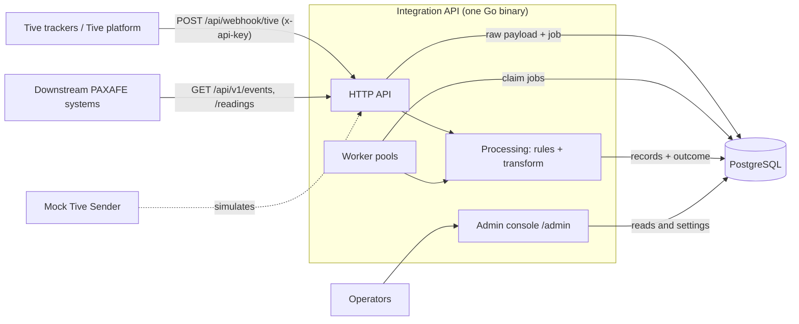
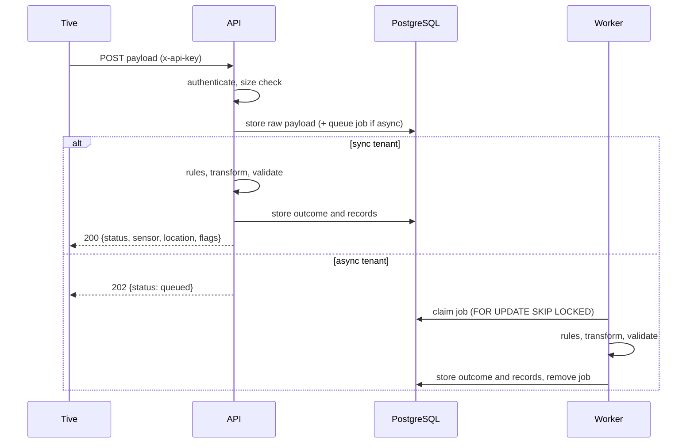

# Architecture

**PAXAFE Tive Integration API** receives webhook payloads from Tive trackers, keeps every payload exactly as received, and converts each one into PAXAFE sensor and location records. This document explains how it is built and why. It is meant to be read top to bottom in about ten minutes.

| | |
|---|---|
| **Status** | Live: https://paxafe-api.onrender.com (admin view `/admin/`, API reference `/docs`) |
| **Companion** | [Mock Tive Sender](https://github.com/yuvasrig/paxafe-mock-sender): simulates Tive for testing |
| **Related** | [DESIGN.md](../DESIGN.md) (full design) · [ADRs](adr/README.md) (decisions) · [RUNBOOK.md](RUNBOOK.md) (operations) · [USER_GUIDE.md](USER_GUIDE.md) (how to use it) |

## Tech stack

| Layer | Choice | Used for |
|---|---|---|
| Language | **Go 1.23** | One statically linked service binary |
| HTTP | Go standard library `net/http` | Routing, handlers, middleware (no web framework) |
| Database | **PostgreSQL 16** | Storage, queue, row-level security, idempotency constraints |
| DB access | `pgx/v5` | Connection pooling and queries (no ORM) |
| Migrations | `goose` | Versioned SQL migrations, applied on start |
| Validation | `santhosh-tekuri/jsonschema` | Checking output against the PAXAFE JSON schemas |
| Rules | YAML (`yaml.v3`) | Configurable rule definitions |
| Logging | `slog` (standard library) | Structured logs with request ids |
| Metrics | Prometheus client | `/metrics` endpoint |
| Admin console | Server-rendered `html/template`, plain CSS and a little JavaScript | Operator view, no external scripts, strict content-security policy |
| API reference | OpenAPI 3 + Redoc | `/docs` and `/openapi.yaml` |
| Packaging | Docker (multi-stage, distroless image) | One image, three roles (`all`, `api`, `worker`) |
| Hosting | Render (web service + managed Postgres, Blueprint) | Live deployment |
| CI | GitHub Actions, `golangci-lint` | Tests, vet and lint gate every deploy |
| Test sender | Go + htmx UI + CLI (separate repository) | Simulates Tive, compares what was sent with what was stored |

## 1. Goals

1. **Never lose an acknowledged payload.** The raw payload is stored before any success answer.
2. **Be accurate and explainable.** Every change made to a payload is recorded as a flag with the rule behind it.
3. **Isolate customers.** Each tenant sees only its own data, enforced by the database.
4. **Stay operable.** Behaviour is changed through configuration (rules, settings), not code releases, and problems raise alerts.
5. **Stay simple.** One Go service, one Postgres database, standard library HTTP.

## 2. System context

The service has three kinds of users: **Tive** (sends data), **PAXAFE systems and tenants** (read results), and **operators** (run the service through the admin view).

## 3. Components

| Component | Where | Responsibility |
|---|---|---|
| **HTTP API** | `internal/httpapi` | Authenticates the key, enforces the 256 KB limit, stores the raw payload, answers. Also serves `/healthz`, `/readyz`, `/metrics`, `/docs`. |
| **Rules engine** | `internal/rules` | Configurable checks and fixes applied to every payload (sentinel values, ranges, type coercion, timestamps, device lookup). Pure functions, no I/O. |
| **Provider (Tive)** | `internal/provider/tive` | Parses Tive JSON and maps it to PAXAFE records. Pure functions; other providers can be added behind the same interface. |
| **PAXAFE records** | `internal/paxafe` | The output types, output rounding, and validation against the PAXAFE JSON schemas. |
| **Ingest service** | `internal/ingest` | Orchestrates one event: processing, idempotency, conflict policy, outcome. Also replay. |
| **Workers** | `internal/worker` | Per-tenant pools that claim queued jobs and process them. Scale up at once, down slowly, under a hard cap. |
| **Store** | `internal/store` | All SQL: `pgx`, row-level security, queue, history. |
| **Settings** | `internal/settings` | Global settings with per-tenant overrides, changed at runtime. |
| **Admin console** | `internal/admin` | Operator view: dashboard, tenants, payloads, compare, conflicts, rules, config, monitoring, notifications. |
| **Alerts** | `internal/alerts` | Rules over live figures; shown in the console, kept as history, optionally posted to a webhook. |
| **Compare** | `internal/compare` | Pure comparison of a received Tive payload with the PAXAFE payload produced from it. |

Design rule: **pure functions for decisions, interfaces only at real boundaries** (provider, store, queue, notifier). This keeps the core easy to test and to read.

## 4. How a payload flows

The steps inside processing:

1. **Parse** the JSON tolerantly (the raw bytes are already stored, so even invalid JSON is kept).
2. **Apply rules.** Each rule can fix, clear, flag, or reject a field. Every action produces a flag.
3. **Transform** into the PAXAFE `sensor` and `location` records and **validate** them against the PAXAFE schemas.
4. **Decide the outcome.** A reading's identity is `(tenant, device IMEI, EntryTimeEpoch)`. The same content again is a `duplicate`; different content is a `conflict`, resolved by the tenant's policy; otherwise `accepted` (no flags) or `flagged` (any flag). A reading with no timestamp or no usable data is `rejected`.

### Sync and async
A tenant is **sync** (processed before the answer) or **async** (stored and queued, answered `202`). Async absorbs bursts: the endpoint only does the cheap, safe step and the workers catch up. The queue is a Postgres table, so the job is created in the **same transaction** as the raw payload and nothing acknowledged can be lost.

## 5. Data model

| Table | Holds |
|---|---|
| `raw_events` | Every payload exactly as received. Never updated or deleted. |
| `event_outcomes` | The result of processing: status, flags, reasons, the PAXAFE records produced, versions. |
| `ingest_jobs` | The async queue (one row per queued event). |
| `sensor_readings`, `location_readings` | Accepted PAXAFE records, with the idempotency key as a unique constraint. |
| `reading_conflicts` | The later version of a conflicting reading, kept for review. |
| `event_outcome_history`, `replay_runs` | Previous outcomes archived by a replay, and an audit of each run. |
| `devices`, `shipments` | Device registry (name to IMEI) and shipment details from the payloads. |
| `tenants`, `api_keys` | Tenants and their hashed keys. |
| `rulesets`, `settings` | Published rules and runtime settings (global and per tenant). |
| `ingest_ledger`, `worker_heartbeats`, `alert_history` | Completeness ledger, live worker status, alert history. |

Raw payloads, outcomes and records are separate so the raw archive stays immutable and a fix can reprocess from it: **replay** re-runs stored payloads through the current rules and records what changed.

## 6. Multi-tenancy and security

- **One tenant per API key.** The tenant comes from the key, never from the payload (`AccountId` is stored as metadata only).
- **Row-level security.** Tenant tables have `FORCE ROW LEVEL SECURITY`. Requests run as a restricted database role with `app.tenant_id` set per transaction, so a query cannot see another tenant's rows even if the code is wrong.
- **Keys** are random, shown once, stored only as hashes, and can expire or be revoked.
- **Admin console** is enabled only when `ADMIN_TOKEN` is set. The session cookie is HttpOnly and SameSite=Strict, state-changing requests must be same-origin, repeated wrong tokens lock sign-in, and a strict content-security policy is applied.
- **Logs** never contain keys or full payloads.

## 7. Reliability

| Concern | Mechanism |
|---|---|
| No loss | Raw payload committed before any 2xx; queue job in the same transaction. |
| Duplicate delivery | Unique key `(tenant, device IMEI, timestamp)`; identical repeats are acknowledged and ignored. |
| Worker crash | Claimed jobs return to the queue; retries with backoff; after `MAX_ATTEMPTS` the event is marked `dead` and can be replayed. |
| Overload | Per-tenant queue limit: beyond it ingest answers `503` with `Retry-After`. Per-tenant worker pools and a cap on total workers keep one tenant from starving others. There is deliberately no rate limiting, because Tive cannot be throttled ([ADR 0002](adr/0002-no-rate-limiting.md)). |
| Bad data | One bad field is cleared and flagged; only a missing timestamp or no usable data rejects a reading. |
| Fixing mistakes | Replay with a dry-run preview; previous outcomes are archived. |

Measured on a laptop (`docs/PERFORMANCE.md`): about 1,200 events per second sustained for an async tenant, nothing acknowledged ever lost.

## 8. Configuration and operation

- **Rules** are data (YAML) with plain-English descriptions in the console. They are validated, versioned automatically, and adopted by every instance within seconds, per tenant if needed. Every event records the rules version that processed it.
- **Settings** (queue limit, worker minimum and maximum, lag target, retries, reject-rate alert) are global with per-tenant overrides and apply without a restart.
- **Observability:** structured `slog` logs, Prometheus metrics at `/metrics`, a live dashboard and monitoring page, and alerts (dead events, no workers, workers behind, queue nearly full, high reject rate) kept in the Notifications tab and optionally posted to a webhook.

## 9. Deployment

One container image runs in three roles chosen by `ROLE`: `all` (API and workers; the default and the free-tier setup), `api`, or `worker` (separate containers for scale-out, see [ADR 0001](adr/0001-deployment-topology.md)). Migrations run on start. On Render the Blueprint (`render.yaml`) creates the web service and a Postgres database; CI (tests, vet, lint) gates every deploy. See [DEPLOY.md](DEPLOY.md).

## 10. Tive to PAXAFE mapping

The transformation runs in two stages: the **rules** clean the payload (coerce numeric strings, clear sentinel values, scale second timestamps, range-check, resolve the device), then the **mapping** below produces the PAXAFE records. Rounding is half away from zero and applied only when the PAXAFE JSON is written; stored values keep full precision.

### Shared fields (sensor and location)

| PAXAFE field | Tive source | How |
|---|---|---|
| `device_id` | `DeviceName` | As sent. Falls back to the IMEI if the name is absent. |
| `device_imei` | `DeviceId` | As sent, or resolved from `DeviceName` (flag `DEVICE_RESOLVED_BY_NAME`). |
| `timestamp` | `EntryTimeEpoch` | Epoch milliseconds. Seconds are multiplied by 1000 first (flag `TIMESTAMP_SECONDS`). `EntryTimeUtc` is ignored. |
| `provider` | none | Constant `"Tive"`. |
| `type` | none | `"Active"`. See the note below the tables. |

### Sensor record

| PAXAFE field | Tive source | How |
|---|---|---|
| `temperature` | `Temperature.Celsius`, else `ProbeTemperature.Celsius` | Rounded to 2 decimals. A sentinel (`-32768`, `327.67`, `32767`) becomes null with `SENSOR_FAULT`. If the device value is null and the probe is usable, the probe is used (`TEMPERATURE_FALLBACK`). If only Fahrenheit is sent, Celsius is computed as (F−32)×5/9 (`TEMPERATURE_CONVERTED`). |
| `humidity` | `Humidity.Percentage` | Rounded to 1 decimal. Outside 0–100 becomes null with `OUT_OF_RANGE`. |
| `light_level` | `Light.Lux` | Rounded to 1 decimal. Negative becomes null with `OUT_OF_RANGE`. |
| `accelerometer.x/y/z` | `Accelerometer.X/Y/Z` | Rounded to 3 decimals. The whole object is null if `Accelerometer` is absent. |
| `accelerometer.magnitude` | `Accelerometer.G` | Rounded to 3 decimals. Computed as √(x²+y²+z²) if `G` is missing. |
| `tilt`, `box_open` | none | Always null. Tive does not provide them. |

If every sensor value is null, no sensor record is produced.

### Location record

| PAXAFE field | Tive source | How |
|---|---|---|
| `latitude`, `longitude` | `Location.Latitude/Longitude` | Full precision. If either is out of range, the whole location record is dropped (`INVALID_COORDINATES`). |
| `altitude` | none | Always null. |
| `location_accuracy` | `Location.Accuracy.Meters` | Rounded to an integer. Null if absent. |
| `location_accuracy_category` | derived from the unrounded accuracy in meters | `High` under 50, `Medium` under 500, otherwise `Low`. Thresholds are configurable. |
| `location_source` | `Location.LocationMethod` | `gps` → `GPS`, `wifi` → `WiFi`, `cell` → `Cellular`, anything else null. |
| `address.full_address` | `Location.FormattedAddress` | Kept verbatim. `address` is null if there is no formatted address. |
| `address.street/locality/state/postal_code/country` | parsed from `FormattedAddress` | Conservative parse of `<street>, <city>, <ST> <ZIP>, <country>`. Anything unmatched is null. |
| `battery_level` | `Battery.Percentage` | Integer, 0–100. |
| `cellular_dbm` | `Cellular.Dbm` | Rounded to 2 decimals. |
| `wifi_access_points` | `Location.WifiAccessPointUsedCount` | Integer. |
| `cellular_network_type`, `cellular_operator` | none | Always null. |

### Rules that apply across all fields

- **Wrong type:** a value of the wrong JSON type becomes null with `INVALID_TYPE`. Numeric strings are coerced first (`COERCED_TYPE`); identifiers such as `DeviceId` are never coerced.
- **Rejection:** a reading is rejected only when it has no usable timestamp (`NO_TIMESTAMP`) or no temperature and no location (`NO_USABLE_DATA`). A rejected reading produces no PAXAFE records but keeps its flags.
- **Status:** `flagged` means the event carries at least one flag; with no flags it is `accepted`.
- **Not in the PAXAFE output** (stored in tables): probe temperature, shipment details, account id, signal strength, battery estimation, charging state and other Tive-only fields.
- **Not judged:** temperatures are never checked against a cold-chain band; a reading is emitted as sent. The right band depends on the product, which the payload does not say.

### Note on `type`

`type` is **`Active`** as of now: the Tive webhook delivers real-time readings from cellular-connected trackers, which matches PAXAFE's definition of an active device, and the payload carries no field that says otherwise. It is therefore set as a constant rather than inferred. If PAXAFE later needs to distinguish devices that upload in batches (`Passive`), the classification should come from device information obtained through Tive's APIs, such as the Tive public API, held as a per-device setting; the service does not call those APIs today.

## 11. Decisions and limits

Decisions and their rejected alternatives are recorded as [ADRs](adr/README.md): Go with the standard library, raw-first ingest, a Postgres queue, immutable raw storage, per-tenant conflict handling, a runtime-configurable rules framework, row-level security, per-tenant worker pools, and no rate limiting.

**Designed but not built:** an in-service reconciler, OpenTelemetry tracing, Prometheus alert rules, a local Kubernetes scaling demo, TimescaleDB, data retention, Tive webhook signature verification and source-address allow-listing, and a backfill job using Tive's pull API.
