# User guide

Two apps work together. The **Mock Tive Sender** pretends to be Tive and sends payloads; the **Integration API** receives them, turns them into PAXAFE records and has an operator console. The screenshots were taken on a local run with demo data.

| App | Live | Local |
|---|---|---|
| Integration API: admin view | https://paxafe-api.onrender.com/admin/ | http://localhost:8080/admin/ |
| Mock Tive Sender | https://paxafe-sender.onrender.com | `go run ./cmd/sender serve` in the sender repo |

The Integration API is a webhook service, so the page you open in a browser is its **admin view** (the operator console, described below); it asks for the admin token. Tive itself talks to `POST /api/webhook/tive`, which has no page. Free Render services sleep when idle; the first request can take about a minute (the sender's home page wakes the API for you).

Contents: [Tutorial](#tutorial-add-a-tenant-send-load-check-the-results) (tenants, load, results, conflicts, comparison) · [Mock Tive Sender](#mock-tive-sender) · [Integration API console](#integration-api-console) · [Command line](#command-line) · [Common tasks](#common-tasks)

## The short version

1. **Get an API key.** An operator makes a tenant in the console's **Tenants** tab (the key is shown once) or runs `api seed` for the demo tenants.
2. **Send data.** Open the sender, paste the key, pick a scenario and press **Run**. (Or point Tive at `POST <api>/api/webhook/tive` with the key in the `x-api-key` header.)
3. **Check the answer.** The sender's report shows what was sent and what the API stored. The console's **Payloads** and **Compare** tabs show the same from the API's side.
4. **Tune it.** Change rules, settings or a tenant's conflict policy in the console; no restart needed. **Conflicts** can then reprocess old events.

## Tutorial: add a tenant, send load, check the results

This walks one new tenant (`globex-pharma`) from creation to verified data. It takes about five minutes. The screenshots are from a local run; on the live deployment use the live URLs from the table above.

**You need:** the console's admin token (`ADMIN_TOKEN`) and the sender's URL. Nothing else is installed.

### Part 1. Add a tenant

1. Open the admin view (`/admin/`) and sign in with the admin token.
2. Click **Tenants**. Under **Add a tenant** fill in:
   - **Id**: lower-case letters, digits and dashes (for example `globex-pharma`). It cannot be changed later.
   - **Name**: a display name (optional).
   - **Ingest**: **sync** answers after processing (HTTP 200, easiest to follow); **async** queues the event, answers `202` and processes it with the tenant's own workers (use it to see queues and workers working).
3. Click **Create tenant and key**.

   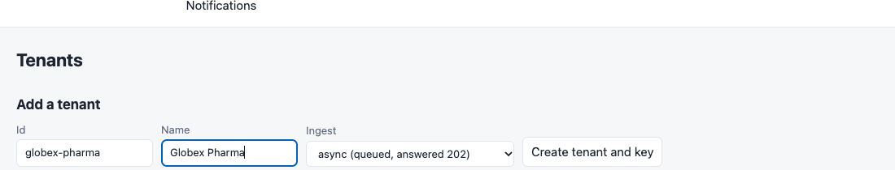

4. **Copy the API key now.** It is shown once and cannot be recovered; if it is lost, issue another key from the same tenant card. The page also gives the webhook URL and a ready-to-paste Tive setup.

   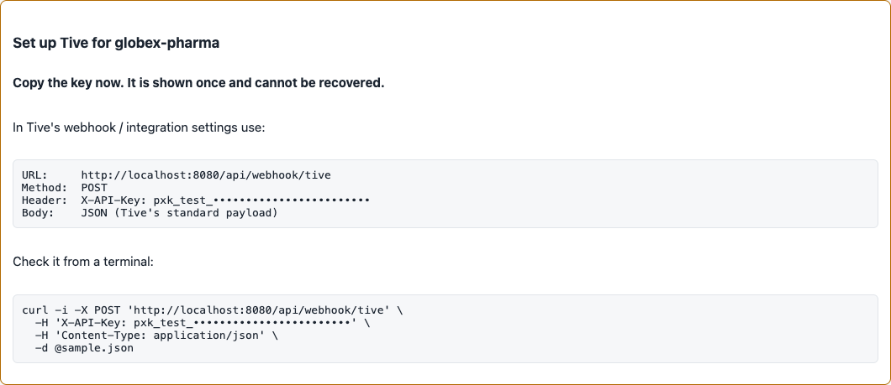

   (In this screenshot the key is masked.)
5. Optional, on the tenant's card: set what happens on a **conflicting duplicate** (keep first, keep last, reject) and the status it answers, or open the tenant's **settings** to override worker limits and the queue limit. Both apply without a restart.

Command-line equivalent: `api tenants create --id globex-pharma`, then `api keys create --tenant globex-pharma`.

### Part 2. Send load

Open the **Mock Tive Sender**. Give the page up to a minute on the live site: it wakes the API first and shows a status line.

1. Scroll to **Load generator**.
2. In **Load 1**:
   - tick one or more **scenarios** (requests are drawn evenly from all ticked ones), for example *Realistic route* and *Sensor fault*;
   - **Tenant label**: any name for the report, for example `Globex`;
   - **API key(s)**: paste the tenant's key (several keys separated by commas run the same load on every tenant at the same time);
   - **Requests/s** and **Duration**: for example 10 and 15;
   - **Start at**: leave empty to start now, or set a time of day.
3. To drive several tenants differently, click **Add another load** (up to 6) and give each its own key, scenarios and rate.
4. Click **Run the plan**.

   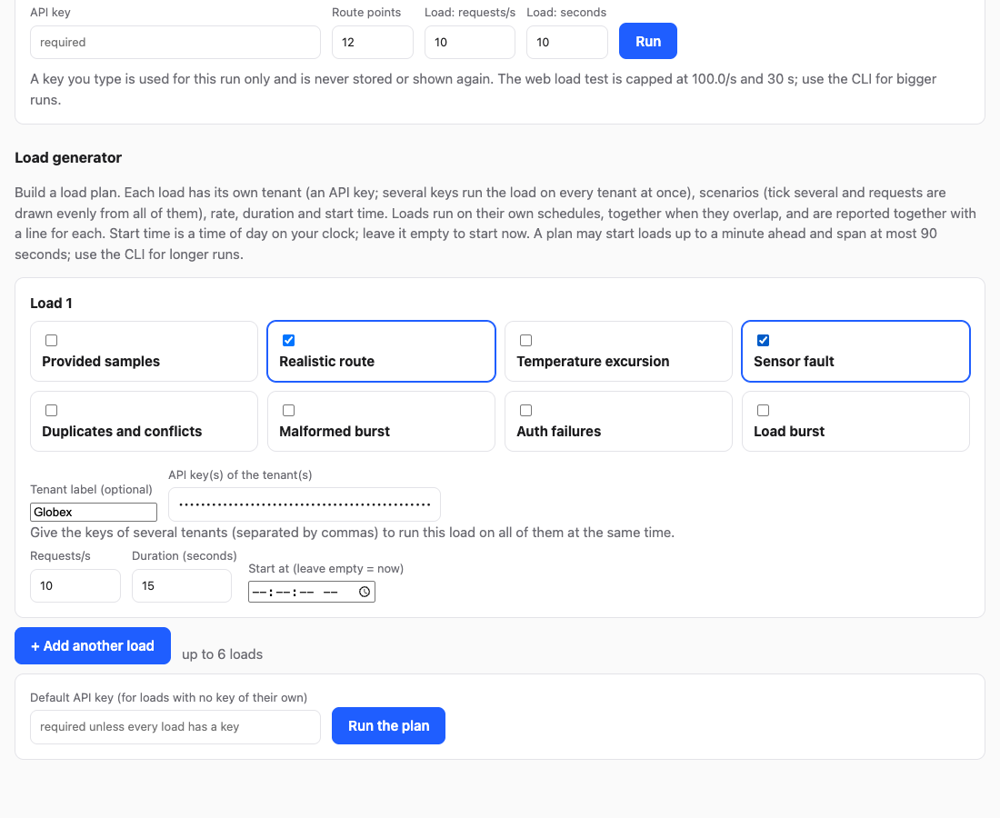

For a single quick run use the **Scenario** box at the top of the page instead (pick a scenario, paste the key, **Run**). From a terminal:

```bash
export API_BASE_URL=https://paxafe-api.onrender.com
go run ./cmd/sender run --scenario route --key <tenant-key>                       # one scenario
go run ./cmd/sender run --load "scenarios=route,fault rate=10 duration=15s key=<tenant-key> label=Globex"
```

### Part 3. Check the results

**a. The sender's report** appears when the run finishes:


It is healthy when **missing** is 0, every check passed, and **sent vs stored** has no "differ (unexplained)". For an async tenant the sender waits for the workers before it compares.

**b. Dashboard** (console): the tenant's row shows events per minute, active devices, workers, completed per minute, queue and oldest wait. An async tenant's **waiting** count rises during the load and returns to 0; **dead** must stay 0.

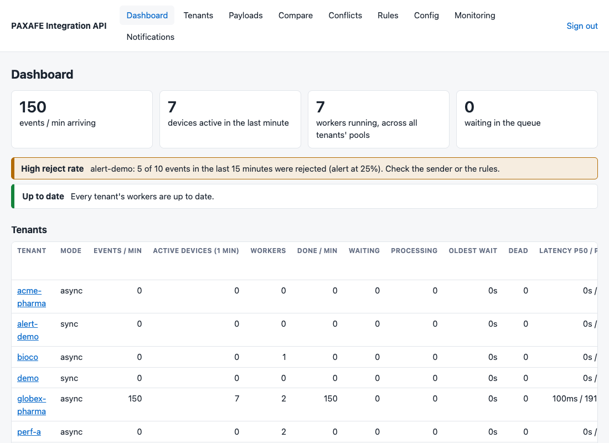

**c. Payloads**: choose the tenant to see the PAXAFE records that were produced, newest first. Open an event to see its Tive payload beside its PAXAFE payload and the flags.

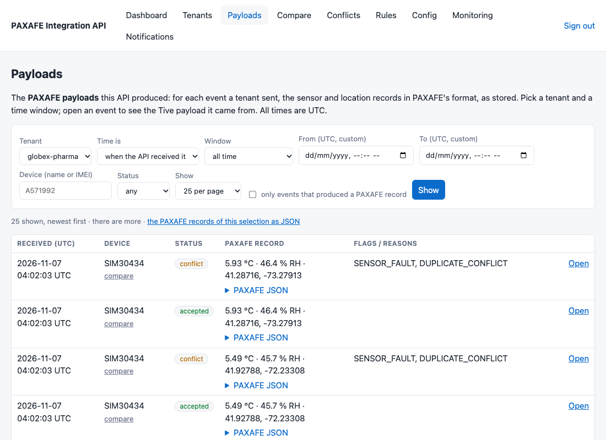

**d. Compare**: choose the tenant and click **compare** next to a device (or pick it in the Compare tab) to chart the Tive payload against the PAXAFE payload.

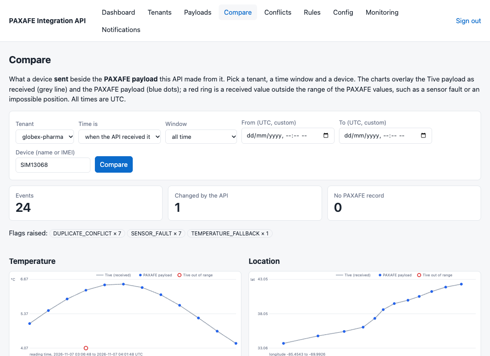

**e. Notifications and Monitoring**: any alert the run caused (for example a high reject rate after a *Malformed burst*) is listed under **Notifications**; **Monitoring** shows live rates, latency and recent rejects.

### Part 4. Conflicts

A **conflict** is a second payload for a reading the API already has (same tenant, same device, same reading time) whose content is different. An identical repeat is only a **duplicate**: nothing is written. What happens to a conflict is the tenant's **conflict policy**:

| Policy | Result |
|---|---|
| **keep first** (default) | The stored reading stays; the later version is saved only for review. |
| **keep last** | The later version replaces the stored reading; the earlier event stays archived. |
| **reject** | Nothing is written for the later version. |

Both versions are always kept, and the tenant's **Answer with** setting chooses whether a conflict is answered `200` or `409`.

1. **Create some.** In the sender, tick **Duplicates and conflicts** in a load (or run `go run ./cmd/sender run --scenario duplicates --key <tenant-key>`).
2. Open **Conflicts** in the console and pick the tenant. Each row is one pair: the device, the reading time (epoch milliseconds), what the policy did (`kept_first`, `kept_last` or `rejected`), the fields that differ with the first value on the left and the later value on the right, and the two event ids (open them under Payloads).

   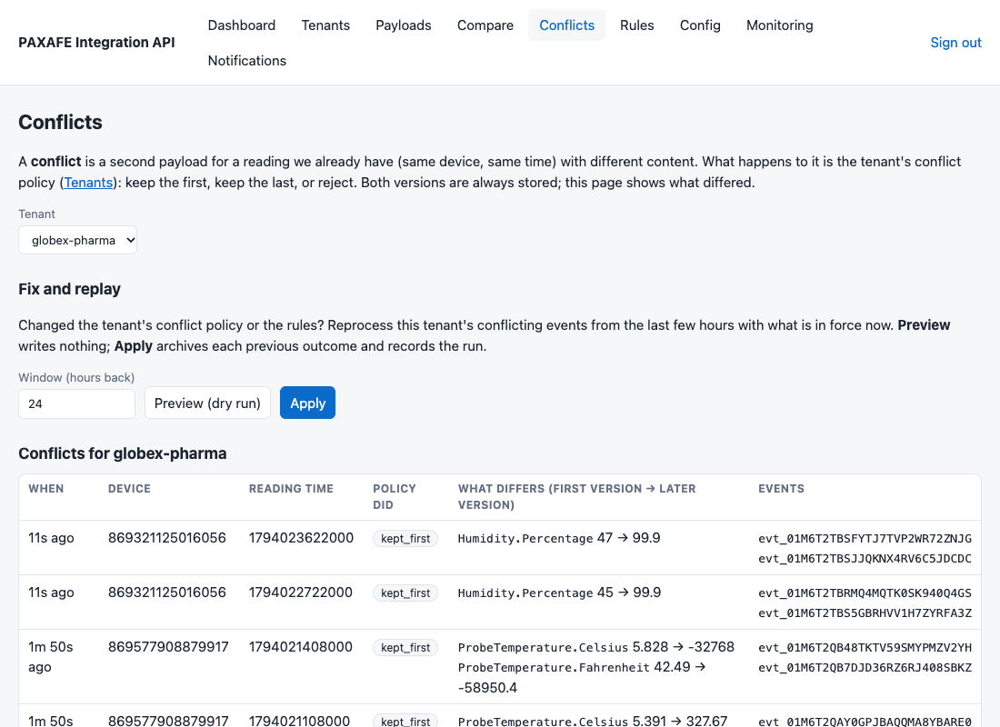

3. **Change the policy** on the tenant's card under **Tenants** if the outcome is not what the tenant wants (for example *keep last* for a tenant whose devices correct earlier readings).
4. **Reprocess what is already stored.** On the Conflicts tab choose how many hours back, then click **Preview (dry run)**: it writes nothing and shows how many events would change and the status changes. If it looks right, click **Apply**: each event's previous outcome is archived, the run is recorded, and raw payloads are never changed.

   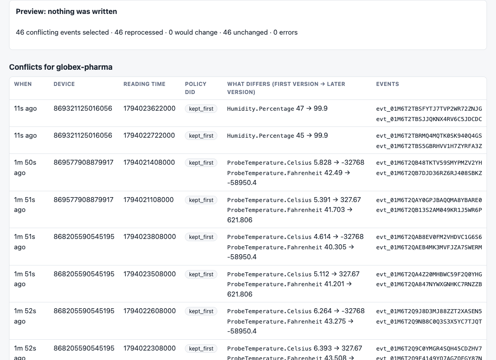

   Command-line equivalent: `api replay --tenant globex-pharma --from <date> --to <date>` (dry run) and add `--apply`.

### Part 5. Compare what was received with the PAXAFE payload

The comparison answers: *for this device, how does the PAXAFE payload differ from the Tive payload that came in?*

1. Open **Compare**, choose the tenant, a window and a device (or click **compare** beside a device on the Payloads tab).
2. Read the **cards**: *Events* in the window, *Changed by the API* (events where a value moved by more than rounding), and *No PAXAFE record* (events that were rejected). **Flags raised** counts each quality flag.
3. Read the **charts**. The grey line is the Tive payload; the blue dots are the PAXAFE payload. Dots on the line mean the value was kept. A **red ring** is a Tive value far outside the range of the PAXAFE values, such as a sensor fault (`-32768`), drawn at the edge of the chart with its real value in the tooltip.
4. Read **What changed**: one row per event the API changed, with the field, the value in the Tive payload and the value in the PAXAFE payload, the flags, and an **Open** link.

   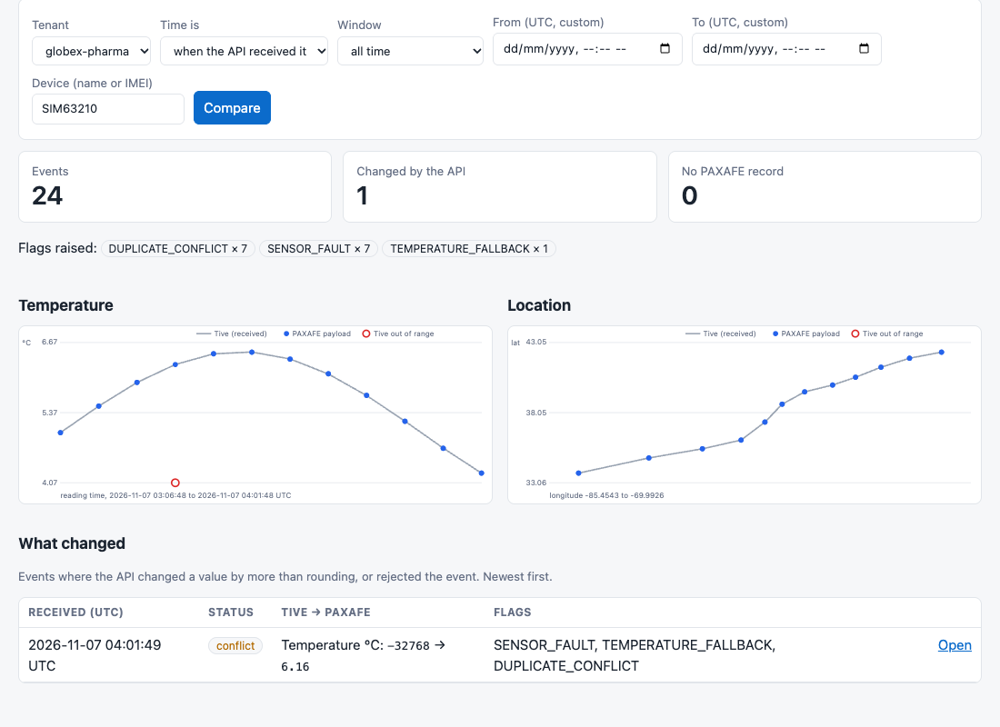

   Here the sensor reported `-32768` (a fault), so the API set the temperature aside, used the probe reading instead (`6.16`), and flagged `SENSOR_FAULT` and `TEMPERATURE_FALLBACK`.
5. Click **Open** for the full picture of one event: a table of every compared field (Tive payload value, PAXAFE payload value, and the rule that acted), the quality flags, and both JSON documents side by side.

Rounding to the PAXAFE precision (for example `4.625` to `4.63`) is shown but not counted as a change. The sender's own report makes the same comparison from the sender's side (what was sent against what the API stored).

### Troubleshooting

| Symptom | Likely cause and fix |
|---|---|
| Sender status stays "Waking the API…" | A free-tier service is starting; wait about a minute. |
| Every request answers 401 | Wrong or revoked key, or a key from another tenant. Issue a new key on the Tenants tab. |
| "No workers" alert, jobs waiting | An async tenant has no running worker: check its worker maximum under **Config** and the global worker cap. See the [runbook](RUNBOOK.md). |
| Payloads page is empty | The window is too short or the wrong tenant is chosen: set **Window** to *all time*. |
| Sender report says events are missing | The workers had not finished within the sender's wait; open Dashboard to see the queue, then run again. |

## Mock Tive Sender

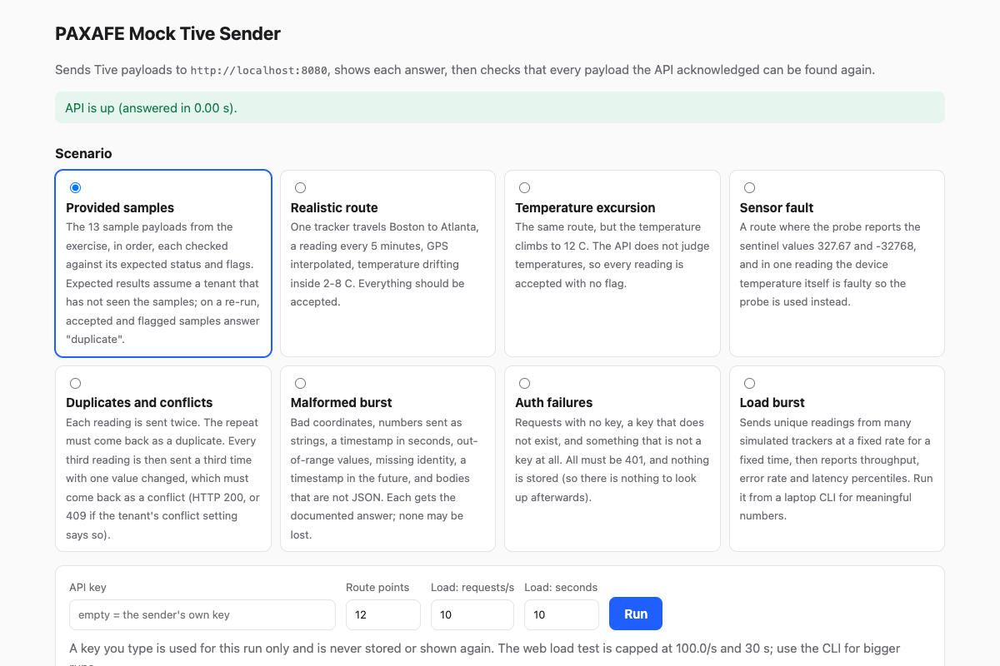

**Scenario.** Pick one of: *Provided samples* (the 13 payloads from the exercise), *Realistic route* (a drive with temperature and position), *Temperature excursion*, *Sensor fault* (sentinel values), *Duplicates and conflicts*, *Malformed burst*, *Auth failures*, *Load burst*.

**Run options.** API key (leave empty to use the sender's own key; a key you type is used for that run only and is never stored), route points, and for load scenarios the rate and duration (the web version is capped; use the CLI for bigger loads).

**Load generator.** Build a plan of several *loads*. Each load has its own tenant key (several keys run it on every tenant at once), one or more scenarios (requests are drawn evenly from them), a rate, a duration and a start time (default now). Use **Add another load** for more rows. This is how to test several tenants at the same time.

**The report** (after Run):

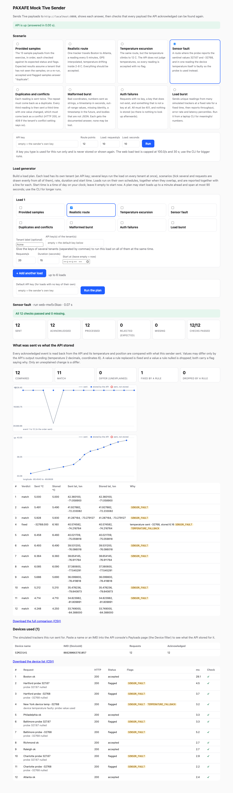

- *Counts:* sent, acknowledged, processed, rejected (expected) and missing. Anything the API acknowledged must be found again; "missing" should be 0.
- *Checks:* each request's HTTP status, outcome and flags against what the scenario expects.
- *What was sent vs what the API stored:* temperature and location charts (sent as a line, stored as dots; a red ring is something sent but not stored) and a row per event with a verdict (**match**, **fixed** by a rule, **dropped** by a rule, or **differ** if unexplained) and the reason. Download it as CSV.
- *Devices used:* the device ids and IMEIs of the run, to look them up in the console.
- For an **async** tenant the sender waits for the workers to finish each event before comparing.

Command line (same engine): `go run ./cmd/sender list`, `go run ./cmd/sender run --scenario route`, see the sender repo's README.

## Integration API console

Open `/admin` and sign in with the operator token (`ADMIN_TOKEN`). Without that variable set the console does not exist. The tabs, left to right (Dashboard, Tenants, Payloads, Compare, Conflicts, Rules, Config, Monitoring, Notifications):

### Dashboard
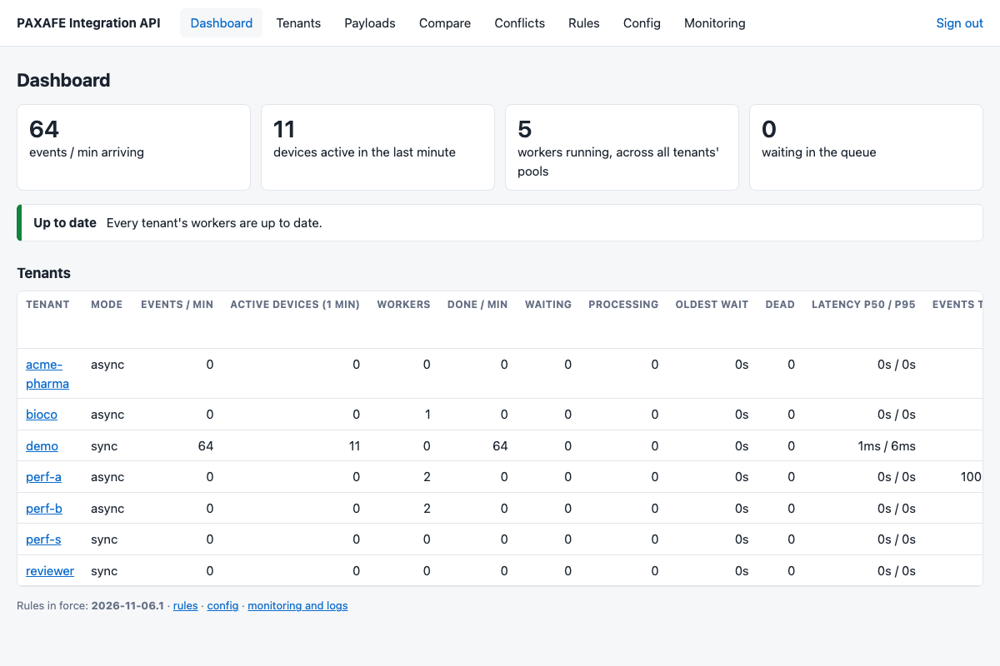

Live figures per tenant: events arriving per minute, devices active, completed per minute, queue depth and oldest wait, latency, and the workers running. Alert banners appear at the top (dead events, no workers, workers behind, queue nearly full, high reject rate). The page refreshes itself.

### Tenants
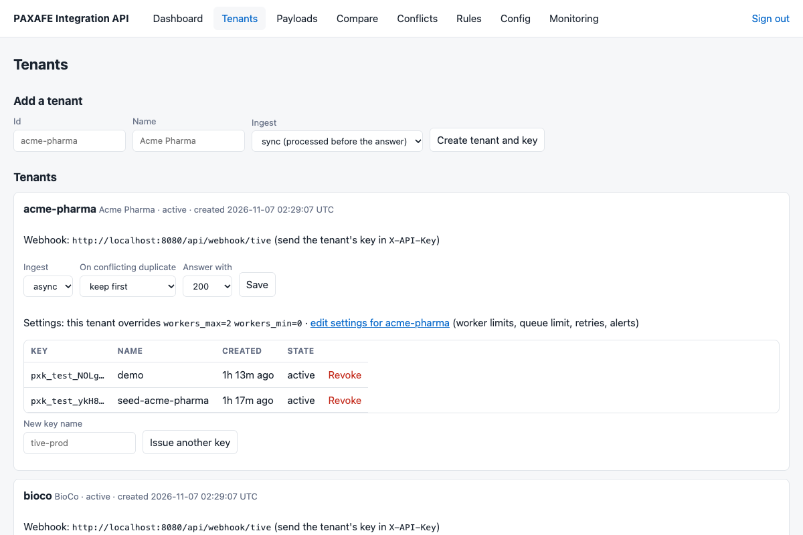

Add a tenant (this also issues its first API key and shows the webhook URL and Tive setup once), choose **sync** (processed before the answer) or **async** (answers `202`, workers process it), set the tenant's conflict policy (*keep first*, *keep last*, *reject*) and the status code it answers (200 or 409), issue or revoke keys, and jump to the tenant's own settings.

### Payloads
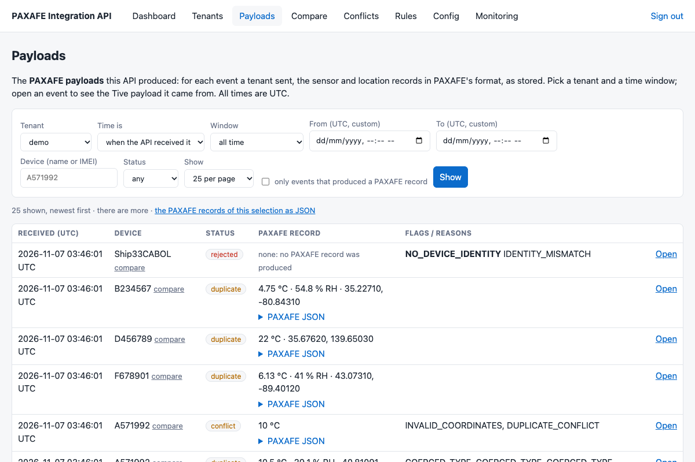

The PAXAFE sensor and location records the API produced, per tenant, newest first. Filter by time (when the API received it, or the reading's own time; last 15 minutes to 7 days or a custom UTC window), device (name or IMEI), status and "only events that produced a record". The device's **compare** link opens the Compare tab. Download the selection as JSON.

Open an event to see it in detail:

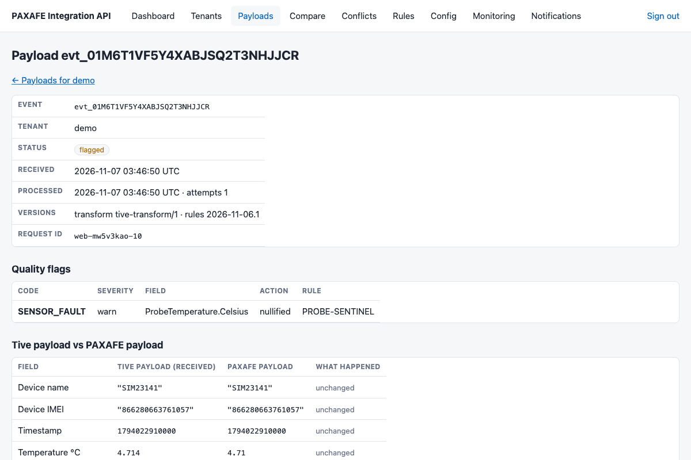

A field-by-field table of the value in the Tive payload (as received) and the value in the PAXAFE payload, with the flag and rule behind any change, the quality flags, why it was rejected (if it was), the PAXAFE JSON and the Tive JSON exactly as received (never modified).

### Compare
Choose a tenant and window. With no device chosen it lists the devices that sent events:

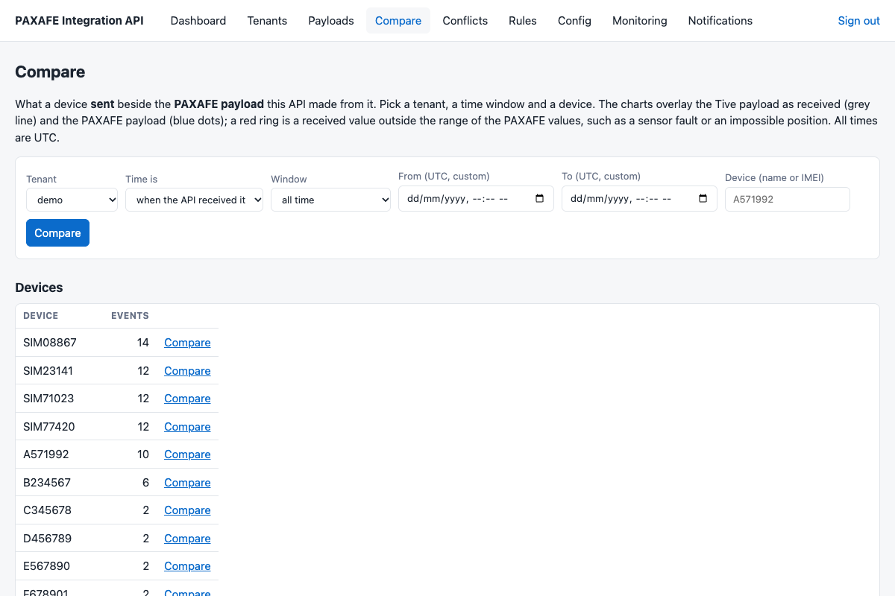

Pick a device:

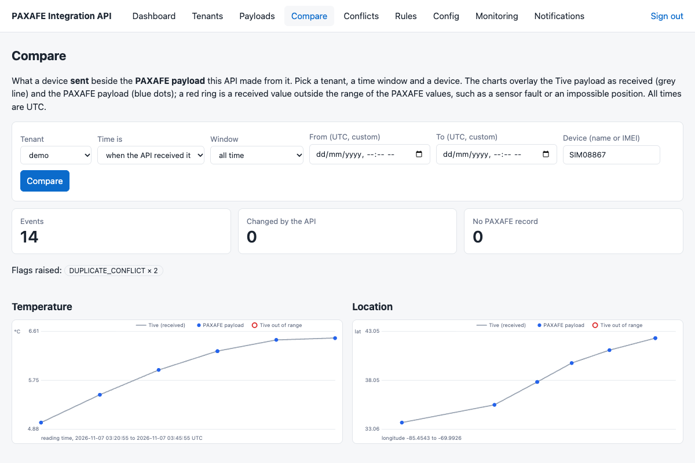

You get counts (events, changed by the API, no PAXAFE record), the flags raised, a temperature chart and a location chart (the Tive payload as a grey line, the PAXAFE payload as blue dots, a Tive value outside the range of the PAXAFE values as a red ring, for example a sensor fault), and below them a list of the events where a value changed by more than rounding.

### Conflicts
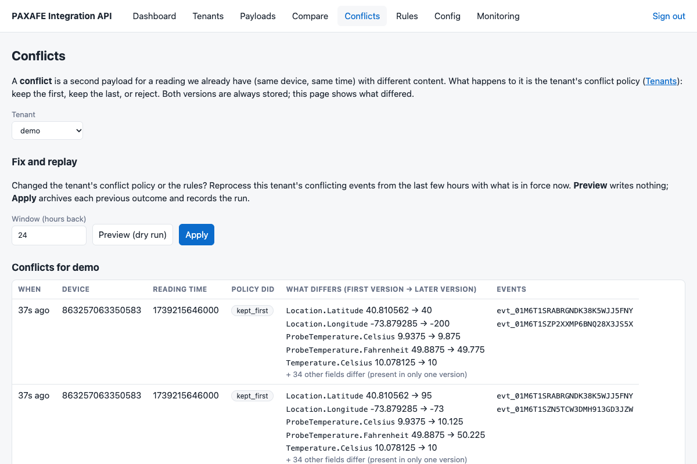

When the same device and timestamp arrive with different content, the pair is listed here with the fields that really differ and what the tenant's policy did. After changing the policy or the rules, **preview** (a dry run) and then **apply** a replay of the conflicting events from the last N hours.

### Rules
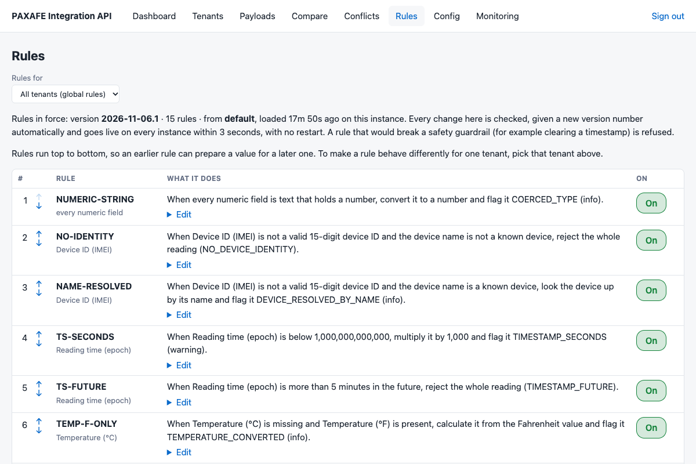

Every check or fix is a rule shown as a plain-English sentence. Switch rules on or off, edit thresholds, action, flag code and severity, reorder or delete them, or add one from dropdowns. Pick a tenant to override a rule for that tenant only. Each change is validated, versioned automatically and live on every instance within seconds; every event records the rules version that processed it. The raw YAML editor, history and reset are under *Advanced*.

### Config
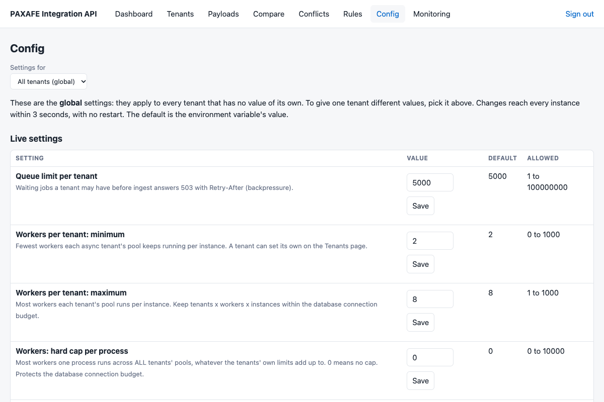

Settings (queue limit, worker minimum and maximum, jobs per worker, lag target, retry attempts, reject-rate alert) are global, and each tenant can override them (choose the scope at the top). Changes apply without a restart. Settings that need a restart are listed read-only; secrets are never shown.

### Monitoring
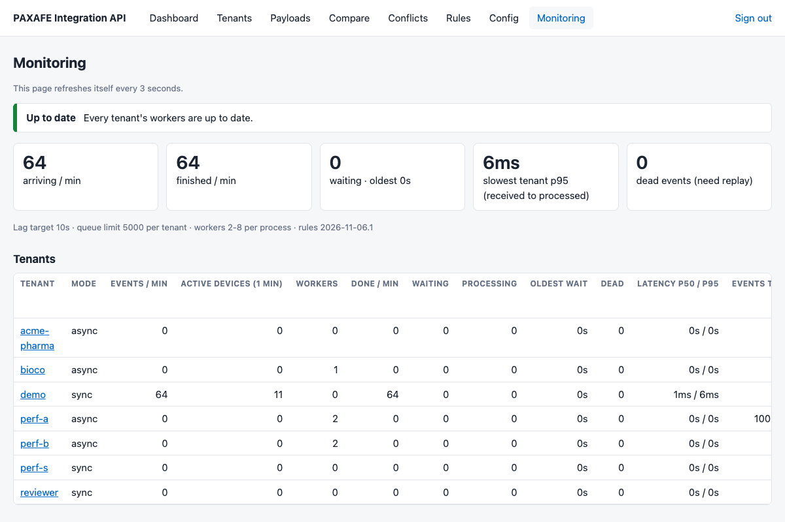

Live rates and latency, recent rejects, conflicts and failures, recent events, the workers, and a prediction of whether the workers are keeping up or how long a backlog needs to clear. Links to `/metrics`, your logs and your dashboard.

### Notifications
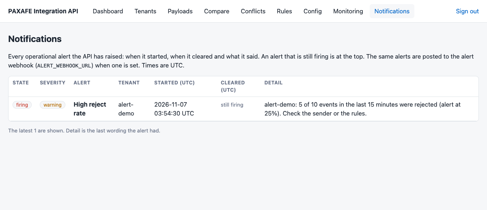

Every operational alert the API has raised, with its severity, tenant, when it started, when it cleared and what it said. Alerts that are still firing are at the top. The alert banners on the Dashboard and Monitoring tabs show only what is firing now; this tab keeps the history. If `ALERT_WEBHOOK_URL` is set (a Slack incoming webhook works) each alert is also posted when it starts and when it clears.

## Command line

Everything the web pages do for load and operations is also available from two command-line tools. Both need Go 1.23 and a clone of the repository.

### Sender CLI (sends load)
In the `paxafe-mock-sender` repository, pointed at the live or a local API:

```bash
export API_BASE_URL=https://paxafe-api.onrender.com      # or http://localhost:8080
export SENDER_API_KEY=<tenant-key>

go run ./cmd/sender list                                  # the scenarios
go run ./cmd/sender run --scenario route                  # one scenario
go run ./cmd/sender run --scenario route,fault --rate 10 --duration 15s
go run ./cmd/sender run --load "scenarios=route,fault rate=10 duration=15s key=<tenant-key> label=Globex"
```
The last form is a load plan: `key=A,B` runs the load on several tenants at once and `--load` can be repeated for several loads. It prints the same report as the web page (`--json` prints it as JSON) and exits non-zero if a check fails.

### API admin CLI (`api`)
This tool talks to the database directly, so it needs `DATABASE_URL`:

```bash
# local stack (docker compose)
docker compose exec api /api tenants create --id globex-pharma
docker compose exec api /api keys create --tenant globex-pharma
docker compose exec api /api rules show

# the deployed database, from your laptop, using the database's External URL
DATABASE_URL='<External URL>?sslmode=require' go run ./cmd/api tenants create --id globex-pharma
```
Other subcommands: `tenants set-conflict`, `tenants set-workers`, `tenants set-setting`, `rules set --file`, and `replay --tenant T --from DATE --to DATE` (dry run; add `--apply` to write). Run any subcommand with `--help` for its flags. The External URL contains the database password, so keep it out of shared chats and logs. The console's Tenants tab does the same as `tenants create` and `keys create` without a database URL.

## Common tasks

| I want to… | Do this |
|---|---|
| Try the exercise samples | Sender, scenario *Provided samples*, Run. Or `scripts/smoke.sh <api> <key>`. |
| See what a rule did to one reading | Payloads, open the event, read *Tive payload vs PAXAFE payload*. |
| Compare a device's readings with what was stored | Compare tab, pick the device. |
| Test several tenants at once | Sender, Load generator, one load with several keys. |
| Change a threshold for one tenant only | Rules (pick the tenant) or Config (pick the tenant). |
| Fix a rule and reprocess old events | Rules (change), then Conflicts (preview, apply) or `api replay`. |
| Find out why something is slow | Dashboard alerts, Monitoring, then the [runbook](RUNBOOK.md). |
| See which alerts fired and when | Notifications tab. |
